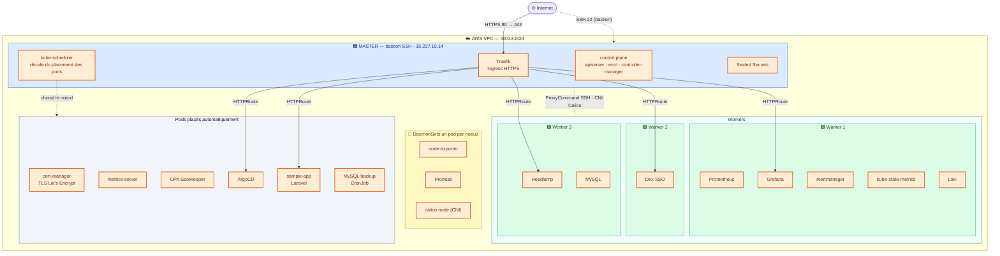

# KubeQuest — T-CLO-902

Déploiement d'un cluster **Kubernetes auto-géré sur AWS EC2** (Amazon Linux 2023), entièrement automatisé avec **Ansible**, et hébergeant :

- une application **Laravel** (`sample-app`) + base **MySQL 8.0**, packagée en **chart Helm** ;
- une stack de **monitoring** (Prometheus, Grafana, Alertmanager, node-exporter) ;
- une stack de **logging** (Loki + Promtail) intégrée à Grafana ;
- un tableau de bord **Headlamp** ;
- un contrôleur **Traefik** (Gateway API) exposant les services en **HTTPS** (certificats TLS Let's Encrypt émis par **cert-manager**) ;
- un **SSO** via **Dex** (OIDC) pour Grafana et Headlamp ;
- la gestion des secrets via **Sealed Secrets** ;
- des **backups MySQL** automatiques (CronJob).

> Ce README est le guide d'**installation complet, pas à pas**. Pour les détails de chaque composant, voir le dossier [`docs/`](docs/) (liens en bas de page).

---

## Documentation détaillée

| Sujet | Document |
| ----- | -------- |
| Architecture Ansible (inventaire, rôles, playbooks) | [docs/ansible.md](docs/ansible.md) |
| Provisioning automatisé du cluster (kubeadm) | [docs/cluster-setup.md](docs/cluster-setup.md) |
| Préparation des VM / install Kubernetes manuelle | [docs/initialize_vms.md](docs/initialize_vms.md) |
| Connexion SSH (bastion / ProxyCommand) | [docs/ssh.md](docs/ssh.md) |
| Choix du CNI (Calico) | [docs/cni.md](docs/cni.md) |
| Traefik architecture | [docs/traefik-architecture.md](docs/traefik-architecture.md) |
| Migration Envoy → Traefik | [docs/traefik-migration.md](docs/traefik-migration.md) |
| HTTPS / TLS (cert-manager, Let's Encrypt) | [docs/cert-manager.md](docs/cert-manager.md) |
| Sealed Secrets | [docs/sealed-secrets.md](docs/sealed-secrets.md) |
| OPA Gatekeeper (policy as code / admission webhook) | [docs/gatekeeper.md](docs/gatekeeper.md) |
| Déploiement Helm (sample-app) | [docs/helm.md](docs/helm.md) |
| metrics-server & autoscaling (HPA) | [docs/metrics-server.md](docs/metrics-server.md) |
| Monitoring (Prometheus/Grafana) | [docs/monitoring.md](docs/monitoring.md) |
| Logging (Loki + Promtail) | [docs/loki-promtail-setup.md](docs/loki-promtail-setup.md) |
| Dex IDP (SSO Grafana, comptes locaux) | [docs/dex.md](docs/dex.md) |
| Headlamp | [docs/headlamp.md](docs/headlamp.md) |
| ArgoCD (SSO via Dex) | [docs/argocd.md](docs/argocd.md) |
| Backups MySQL | [docs/mysql-backup.md](docs/mysql-backup.md) |
| Flux de déploiement CI/CD | [docs/deployment-flow.md](docs/deployment-flow.md) |
| CI/CD workflows GitHub Actions | [docs/ci-cd.md](docs/ci-cd.md) |
| GitOps (sans ArgoCD) | [docs/gitops.md](docs/gitops.md) |

## Équipe

| Nom |
| --- |
| Alexandre TRESSEL |
| Denys NAVARRO |
| Mohamed AZDOUD |
| Valentin RAGOT |
| Yann PLOUHINEC |

---

## 1. Architecture cible



| Composant | Rôle | Emplacement |
| --------- | ---- | ----------- |
| **Master** | Control-plane + bastion SSH + Traefik + cert-manager | EC2 publique `15.237.15.14` |
| **Worker 1** | Stack monitoring (Prometheus/Grafana/Alertmanager) + apps | EC2 privée (accès via bastion master) |
| **Worker 2** | Dex IDP + apps | EC2 privée (accès via bastion master) |
| **Worker 3** | Headlamp + apps | EC2 privée (accès via bastion master) |
| **Logging** | Loki (SingleBinary, non épinglé) + Promtail (DaemonSet) | namespace `monitoring` |
| **Sealed Secrets** | Contrôleur de déchiffrement (`kube-system`, non épinglé) | un worker (scheduler) |
| **cert-manager** | Émission/renouvellement TLS (Let's Encrypt) | namespace `cert-manager` |
| **CNI** | Calico `v3.31.4` | tous les noeuds |
| **Kubernetes** | `v1.35` (kubeadm) | — |

> Le **master est le seul noeud accessible depuis Internet**. Les workers sont joints en SSH via un **ProxyCommand** (jump host) à travers le master. Voir [docs/ssh.md](docs/ssh.md).

---

## 2. Prérequis

### 2.1 Sur votre machine locale (poste d'administration)

| Outil | Version conseillée | Usage |
| ----- | ------------------ | ----- |
| `ansible` | ≥ 2.15 | Orchestration du déploiement |
| `ansible-galaxy` collection `kubernetes.core` | — | Modules `k8s` / `helm` |
| `kubeseal` | ≥ 0.32 | Chiffrement des secrets (Sealed Secrets) |
| `kubectl` | ≥ 1.30 | (optionnel) administration locale |
| `git` | — | Cloner le dépôt |
| Clé SSH | `~/.ssh/kubequest.pem` | Accès aux EC2 (`chmod 600`) |

Installation de Ansible :

```bash
sudo apt-get install ansible
```

Placez la clé SSH et restreignez ses droits :

```bash
cp kubequest.pem ~/.ssh/kubequest.pem
chmod 600 ~/.ssh/kubequest.pem
```

### 2.2 Sur les instances EC2 (préparé automatiquement par Ansible)

- Amazon Linux 2023, utilisateur `ec2-user` avec `sudo`.
- Python `3.9` (`/usr/bin/python3.9`).
- **Security Group** : ports **22** (SSH, au moins sur le master), **80** (HTTP redirection vers HTTPS + challenge ACME Let's Encrypt) et **443** (HTTPS) ouverts sur le master.

> L'installation des paquets (containerd, kubeadm, kubelet, kubectl), la désactivation du swap et la configuration réseau sont prises en charge par le rôle `k8s_common`. Le détail manuel équivalent est documenté dans [docs/initialize_vms.md](docs/initialize_vms.md).

---

## 3. Structure du dépôt

```
.
├── ansible/                 # Playbooks & rôles d'automatisation
│   ├── inventory.yml        # Hôtes (master + workers) et accès SSH
│   ├── ansible.cfg          # Config Ansible (inventory, SSH, log)
│   ├── group_vars/all.yml   # Variables globales (versions, hostnames...)
│   ├── deploy_all.yml       # ⭐ Déploiement complet (orchestrateur)
│   └── roles/               # k8s_common, k8s_master, k8s_worker, traefik,
│                            #   monitoring, headlamp, sealed_secrets, ...
├── charts/sample-app/       # Chart Helm de l'application Laravel + MySQL
├── gitops/sample-app/       # Values GitOps (image, réplicas, HPA)
├── infra/                   # Manifests Kustomize (traefik, cert-manager, dex, monitoring, loki, headlamp)
├── resources/sample-app-master/  # Code source Laravel
├── .github/workflows/       # CI/CD (build image, publish chart, deploy)
└── docs/                    # Documentation détaillée par composant
```

---

## 4. Installation pas à pas

> **Toutes les commandes Ansible se lancent depuis le dossier `ansible/`** (où se trouve `ansible.cfg` qui pointe déjà vers `inventory.yml`).

```bash
git clone <url-du-depot> T-CLO-902-NAN_1
cd T-CLO-902-NAN_1/ansible
```

### Étape 1 — Configurer l'inventaire

Éditez [`ansible/inventory.yml`](ansible/inventory.yml) pour refléter votre infrastructure :

- `master.ansible_host` : **IP publique** du master (bastion).
- `master.internal_ip` : IP privée VPC du master.
- `worker1/2/3.ansible_host` : **IP privées** des workers.
- Dans `ansible_ssh_common_args`, remplacez l'IP du bastion (`ec2-user@15.237.15.14`) par votre IP publique master.
- `ansible_ssh_private_key_file` : chemin de votre clé (`~/.ssh/kubequest.pem`).

### Étape 2 — Vérifier la connectivité SSH

```bash
ansible-playbook test_connectivity.yml
# ou via deploy_all :
ansible-playbook deploy_all.yml --tags connectivity
```

Tous les hôtes doivent répondre (master en direct, workers via le ProxyCommand).

### Étape 3 — Déploiement complet (recommandé)

Un seul playbook orchestre tout l'enchaînement :
`connectivité → cluster → metrics-server → sealed-secrets → gatekeeper → Traefik → cert-manager → Dex → monitoring → Loki → Headlamp → sample-app`.

```bash
ansible-playbook -i ansible/inventory.yml ansible/deploy_all.yml
```

> **Important** : l'étape `sample-app` nécessite que les secrets aient été générés au préalable (voir [Étape 5](#étape-5--préparer-les-secrets-sealed-secrets)) et que `GITHUB_USER` / `GITHUB_TOKEN` soient exportés **une seule fois** (création du secret de registry GHCR). Si vous découvrez le projet, lancez d'abord les étapes 4 → 5 puis l'étape 6, ou exécutez `deploy_all.yml` jusqu'au monitoring (`--skip-tags app`) puis préparez les secrets avant de déployer l'app.

### Étape 4 — Déploiement étape par étape (alternative / dépannage)

`deploy_all.yml` accepte des **tags** pour rejouer une partie seulement :

```bash
# 4.1 Installer le cluster Kubernetes (control-plane + workers + Calico)
ansible-playbook -i ansible/inventory.yml ansible/deploy_all.yml --tags cluster

# 4.2 metrics-server (requis pour le HPA et kubectl top)
ansible-playbook -i ansible/inventory.yml ansible/deploy_all.yml --tags metrics-server

# 4.3 Sealed Secrets (contrôleur de déchiffrement)
ansible-playbook -i ansible/inventory.yml ansible/deploy_all.yml --tags sealed-secrets

# 4.4 OPA Gatekeeper (admission webhook + politiques de sécurité sample-app)
ansible-playbook -i ansible/inventory.yml ansible/deploy_all.yml --tags gatekeeper

# 4.5 Traefik (CRDs Gateway API + Helm + Gateway public)
ansible-playbook -i ansible/inventory.yml ansible/deploy_all.yml --tags gateway

# 4.6 cert-manager (Helm + ClusterIssuers Let's Encrypt + certificat wildcard TLS)
ansible-playbook -i ansible/inventory.yml ansible/deploy_all.yml --tags cert-manager

# 4.7 Dex IDP (SSO comptes locaux ; prérequis : SealedSecrets scellés voir docs/dex.md)
ansible-playbook -i ansible/inventory.yml ansible/deploy_all.yml --tags dex

# 4.8 Stack monitoring (Prometheus / Grafana / Alertmanager + SSO Grafana via Dex)
ansible-playbook -i ansible/inventory.yml ansible/deploy_all.yml --tags monitoring

# 4.9 Stack logging (Loki + Promtail, intégrés à Grafana)
ansible-playbook -i ansible/inventory.yml ansible/deploy_all.yml --tags logging

# 4.10 Headlamp (dashboard)
ansible-playbook -i ansible/inventory.yml ansible/deploy_all.yml --tags headlamp

# 4.11 Application Laravel + MySQL
ansible-playbook -i ansible/inventory.yml ansible/deploy_all.yml --tags app
```

Chaque étape dispose aussi de son playbook dédié, équivalent :

| Tag | Playbook dédié |
| --- | -------------- |
| `connectivity` | `test_connectivity.yml` |
| `cluster` | `setup_cluster_playbook.yml` |
| `metrics-server` | `deploy_metrics_server.yml` |
| `sealed-secrets` | `deploy_sealed_secrets.yml` |
| `gatekeeper` | `install_gatekeeper.yml` + `deploy_gatekeeper.yml` |
| `gateway` | `install_traefik.yml` + `deploy_traefik.yml` |
| `cert-manager` | `install_cert_manager.yml` + `deploy_cert_manager.yml` |
| `dex` | `deploy_dex.yml` |
| `monitoring` | `deploy_monitoring.yml` |
| `logging` | `deploy_loki.yml` |
| `headlamp` | `deploy_headlamp.yml` |
| `app` | `deploy_app.yml` |

### Étape 5 — Préparer les secrets (Sealed Secrets)

Avant de déployer l'application (et le monitoring / Dex), les **secrets doivent être scellés** avec la clé publique du contrôleur Sealed Secrets du cluster cible :

- **sample-app** : `APP_KEY` Laravel + mot de passe MySQL → `charts/sample-app/values.sealed.yaml` ;
- **Grafana / Dex** : identifiants admin Grafana, hash bcrypt + client secrets OAuth → `infra/monitoring/`, `infra/dex/` ;
- **Headlamp** : configuration OIDC → `infra/headlamp/headlamp-oidc-sealedsecret.yaml`.

Procédure de scellement détaillée : [docs/sealed-secrets.md](docs/sealed-secrets.md) (et [docs/dex.md](docs/dex.md) pour les secrets SSO). Les fichiers `SealedSecret` produits sont chiffrés et **sûrs à committer**.

### Étape 6 — Déployer l'application

Le pull de l'image se fait depuis **GHCR** : un `imagePullSecret` est créé à partir d'un token GitHub (scope `read:packages`). À fournir **une seule fois** (le secret persiste ensuite) :

```bash
export GITHUB_USER="<github-username>"
export GITHUB_TOKEN="<github-token>"   # scope read:packages

ansible-playbook -i ansible/inventory.yml ansible/deploy_app.yml
```

Le playbook : crée le namespace `sample-app`, crée le secret registry GHCR, déploie le chart Helm (`helm upgrade --install`), attend le déchiffrement du SealedSecret, puis le rollout du Deployment.

> Déploiement manuel équivalent et options du chart : [docs/helm.md](docs/helm.md).
