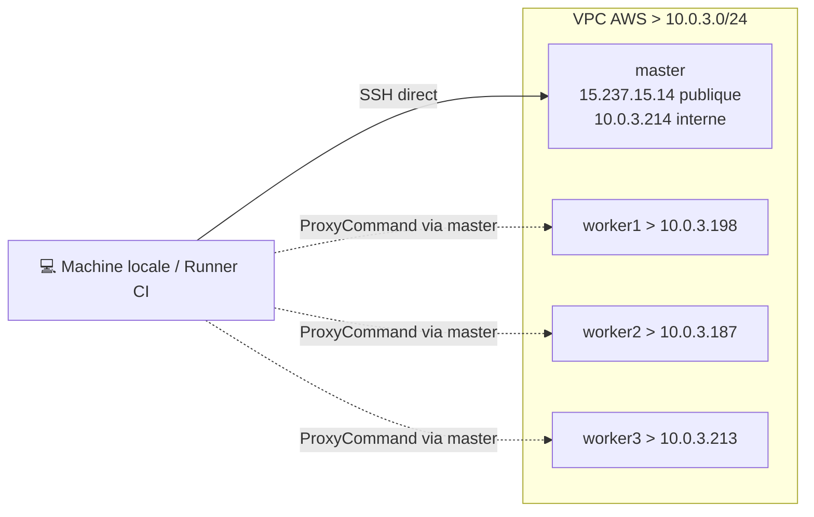

# Architecture Ansible

Toute l'infrastructure KubeQuest est pilotée par Ansible depuis le dossier [`ansible/`](../ansible/).
Ce document décrit l'**inventaire**, les **variables**, le **catalogue des rôles et playbooks**,
et l'**ordre d'orchestration**.

## Principe général

- Les playbooks ciblent les EC2 via SSH ; le **master** sert de **bastion** pour les workers (réseau privé VPC). Voir [`docs/ssh.md`](ssh.md).
- Le master possède le kubeconfig admin (`/etc/kubernetes/admin.conf`) ; c'est depuis lui que s'exécutent les actions `kubectl` / `helm` (modules `kubernetes.core`).
- Chaque playbook est un *wrapper* mince autour d'un ou plusieurs **rôles**.

## Inventaire (`inventory.yml`)



| Groupe | Hôtes | Accès |
| ------ | ----- | ----- |
| `k8s_master` | `master` (`15.237.15.14`, interne `10.0.3.214`) | SSH direct (IP publique) |
| `k8s_workers` | `worker1/2/3` (IP privées) | SSH via **ProxyCommand** à travers le master |
| `k8s_cluster` | `k8s_master` + `k8s_workers` | groupe parent |

Variables communes (`all.vars`) :

| Variable | Valeur |
| -------- | ------ |
| `ansible_user` | `ec2-user` |
| `ansible_become` | `yes` (sudo -> root) |
| `ansible_ssh_private_key_file` | `~/.ssh/kubequest.pem` |

Les workers définissent `ansible_ssh_common_args` avec un `ProxyCommand` qui rebondit sur
`ec2-user@15.237.15.14`. Seul le master expose une IP publique ; les ports applicatifs ouverts sont
le **80** (redirection HTTP->HTTPS + challenge ACME) et le **443** (HTTPS), voir
[`docs/traefik-architecture.md`](traefik-architecture.md).

## Configuration (`ansible.cfg`)

| Clé | Valeur | Rôle |
| --- | ------ | ---- |
| `inventory` | `inventory.yml` | Inventaire par défaut |
| `host_key_checking` | `False` | Pas de prompt de clé d'hôte (EC2 éphémères) |
| `forks` | `10` | Parallélisme |
| `log_path` | `./ansible.log` | Journal d'exécution |
| `ssh_args` | `ControlMaster/ControlPersist=300s` | Multiplexage SSH (perf AWS) |
| `pipelining` | `True` | Moins d'allers-retours SSH par tâche |

## Variables - deux niveaux

Les variables sont réparties en deux endroits :

1. **`group_vars/all.yml`** variables **transverses** (partagées par plusieurs rôles) et *facts* dérivés de l'inventaire.
2. **`roles/<rôle>/defaults/main.yml`** variables **spécifiques** à un rôle (versions, namespaces, URLs de manifestes propres au composant).

### Transverses (`group_vars/all.yml`)

`all.yml` ne conserve que le strict minimum partagé et les *facts* dérivés de l'inventaire :

| Domaine | Variables clés |
| ------- | -------------- |
| KUBECONFIG | `k8s_master_config` (`admin.conf`), `k8s_worker_config` (`kubelet.conf`) |
| Gateway API | `gateway_api_crds_url` (CRDs `v1.5.1`) |
| Facts dérivés | `master_public_ip`, `master_internal_ip`, `worker{1,2,3}_internal_ip` |

### Spécifiques au rôle (`defaults/main.yml`)

| Rôle | Variables clés |
| ---- | -------------- |
| `k8s_common` | `k8s_version` (`v1.35`), `containerd_config_dir`, `containerd_config_file` |
| `k8s_master` | `calico_version` (`v3.31.4`), `calico_manifest_url` |
| `metrics_server` | `metrics_server_kustomize_src`, `metrics_server_namespace`, `metrics_server_rollout_timeout` (manifest `v0.7.2` + patch -> `infra/metrics-server/`) |
| `sealed_secrets` | `sealed_secrets_controller_version` (`0.32.2`), `sealed_secrets_chart_version` (`2.17.7`), repo |
| `traefik` | `traefik_chart_version` (`v40.2.0`), `traefik_namespace`, `gateway_name` (`public-gateway`), `traefik_kustomize_src` (config Helm -> `infra/traefik/values.yaml`) |
| `cert_manager` | `cert_manager_chart_version` (`v1.20.2`), `cert_manager_namespace`, `cert_manager_kustomize_src` (config Helm -> `infra/cert-manager/values.yaml` ; ClusterIssuers/Certificate -> `infra/cert-manager/`) |
| `monitoring` | `monitoring_namespace`, `monitoring_chart_version` (`85.0.3`), `monitoring_storage_class`, `local_path_storage_kustomize_src` (manifest `v0.0.36` + patches -> `infra/local-path-storage/`), `local_path_provisioner_rollout_timeout`, `monitoring_kustomize_src` (config applicative -> `infra/monitoring/values.yaml`) |
| `dex` | `dex_chart_version` (`0.23.0`), `dex_namespace`, `dex_kustomize_src` |
| `loki` | `loki_chart_version` (`7.0.0`), `promtail_chart_version` (`6.17.1`), `loki_namespace` (`monitoring`) |
| `headlamp` | `headlamp_namespace`, `headlamp_chart_repo_url`, `headlamp_kustomize_src` |

> Règle : une variable utilisée par **un seul** rôle vit dans ses `defaults` ; une variable partagée (ou un *fact* d'inventaire) vit dans `group_vars/all.yml`. Pour surcharger une valeur par défaut de rôle, la (re)définir dans `group_vars/all.yml` (priorité supérieure aux `defaults`).

## Catalogue des rôles

| Rôle | Rôle joué | Doc |
| ---- | --------- | --- |
| `k8s_common` | Préparation des noeuds (swap, modules, containerd, paquets k8s) | [cluster-setup](cluster-setup.md) |
| `k8s_ansible_deps` | Prérequis `kubernetes.core` (pip, Helm) sur le master | [cluster-setup](cluster-setup.md) |
| `k8s_master` | `kubeadm init`, Calico, génération du join | [cluster-setup](cluster-setup.md) |
| `k8s_worker` | `kubeadm join` | [cluster-setup](cluster-setup.md) |
| `metrics_server` | metrics-server (HPA / `kubectl top`) | [metrics-server](metrics-server.md) |
| `sealed_secrets` | Contrôleur Sealed Secrets (Helm) | [sealed-secrets](sealed-secrets.md) |
| `gatekeeper` | OPA Gatekeeper (validating admission webhook, Helm chart `3.22.2`) + ConstraintTemplates/Constraints | ci-dessous |
| `traefik` | Traefik + Gateway API (CRDs, GatewayClass, Gateway) | [traefik-architecture](traefik-architecture.md) |
| `cert_manager` | cert-manager (Helm) + ClusterIssuers Let's Encrypt + Certificate TLS | [cert-manager](cert-manager.md) |
| `dex` | Dex IDP (SSO OIDC Grafana, Headlamp) | [dex](dex.md) |
| `argocd` | ArgoCD (GitOps, Helm chart `7.8.23`) + HTTPRoute | ci-dessous |
| `monitoring` | kube-prometheus-stack + HTTPRoutes | [monitoring](monitoring.md) |
| `loki` | Loki (logs) + Promtail (collecte) | [loki-promtail-setup](loki-promtail-setup.md) |
| `headlamp` | Headlamp (Helm + Kustomize) | [headlamp](headlamp.md) |
| `test_connectivity` | Vérification SSH/hostnames des noeuds | ci-dessous |

## Catalogue des playbooks

| Playbook | Rôle(s) | Hôtes |
| -------- | ------- | ----- |
| `test_connectivity.yml` | `test_connectivity` | `k8s_cluster` |
| `setup_cluster_playbook.yml` | `k8s_common`, `k8s_master`, `k8s_worker` | cluster |
| `deploy_metrics_server.yml` | `metrics_server` | master |
| `deploy_sealed_secrets.yml` | `sealed_secrets` | master |
| `install_gatekeeper.yml` | `gatekeeper` (tasks `install`) | master |
| `deploy_gatekeeper.yml` | `gatekeeper` (tasks `deploy`) | master |
| `install_traefik.yml` | `traefik` (tasks `install`) | master |
| `deploy_traefik.yml` | `traefik` (tasks `deploy`) | master |
| `install_cert_manager.yml` | `cert_manager` (tasks `install`) | master |
| `deploy_cert_manager.yml` | `cert_manager` (tasks `deploy`) | master |
| `deploy_dex.yml` | `dex` | master |
| `install_argocd.yml` | `argocd` (tasks `install`) | master |
| `deploy_argocd.yml` | `argocd` (tasks `deploy`) | master |
| `deploy_monitoring.yml` | `monitoring` | master |
| `deploy_loki.yml` | `loki` | master |
| `deploy_headlamp.yml` | `headlamp` | master |
| `deploy_app.yml` | déploiement Helm `sample-app` + secret GHCR (**autonome**, non importé par `deploy_all.yml`) | master |
| `demo_break_worker.yml` | démo : mise en panne d'un worker (avec/sans reschedule) | master |
| `demo_restore_worker.yml` | démo : restauration des workers cordonnés | master |
| `cleanup_traefik.yml` | suppression des ressources Traefik | master |
| `cleanup_gateway.yml` | reset complet des ressources Envoy Gateway (namespace `envoy-gateway-system`) | master |
| `cleanup_cert_manager_traefik.yml` | nettoyage de cert-manager et Traefik pour repartir au propre | master |
| `deploy_all.yml` | **orchestrateur** (import des playbooks ci-dessus, hors `deploy_app.yml`) | tous |

## Orchestration : `deploy_all.yml`

Le déploiement complet enchaîne les playbooks dans cet ordre :

```mermaid
flowchart LR
    a[test_connectivity] --> b[setup_cluster] --> c[metrics_server]
    c --> d[sealed_secrets] --> e[install_gatekeeper] --> f[deploy_gatekeeper]
    f --> g[install_traefik] --> h[deploy_traefik] --> i[cert_manager install+deploy]
    i --> j[dex] --> k[install_argocd] --> l[deploy_argocd]
    l --> m[monitoring] --> n[loki] --> o[headlamp]
```



> `deploy_app.yml` n'est **pas** importé par `deploy_all.yml` : la sample-app se déploie séparément (voir [`docs/helm.md`](helm.md)).

```bash
cd ansible
ansible-playbook -i ansible/inventory.yml ansible/deploy_all.yml
```

Chaque étape porte un **tag** permettant une exécution ciblée :

| Tag | Étape |
| --- | ----- |
| `connectivity` | Vérification SSH |
| `cluster` | Cluster + metrics-server + Sealed Secrets (tag transverse) |
| `metrics-server` | metrics-server seul |
| `sealed-secrets` | Contrôleur Sealed Secrets |
| `security` | Gatekeeper (install + deploy) (tag transverse) |
| `gatekeeper` | Gatekeeper (install + deploy) |
| `gatekeeper-install` | Gatekeeper (install du chart Helm seul) |
| `gatekeeper-deploy` | Gatekeeper (ConstraintTemplates + Constraints seuls) |
| `http` | Traefik + cert-manager (tag transverse) |
| `gateway` | Traefik (install + deploy) |
| `gateway-install` | Traefik (install seul) |
| `gateway-deploy` | Traefik (deploy seul) |
| `cert-manager` | cert-manager + ClusterIssuers + Certificate TLS |
| `cert-manager-install` | cert-manager (install seul) |
| `cert-manager-deploy` | ClusterIssuers + Certificates seuls |
| `monitor` | Dex + monitoring + logging + headlamp (tag transverse) |
| `dex` | Dex IDP (SSO) |
| `argocd` | ArgoCD (install + deploy) |
| `argocd-install` | ArgoCD (install seul) |
| `argocd-deploy` | ArgoCD (HTTPRoute + ressources seules) |
| `monitoring` | Prometheus/Grafana |
| `logging` | Loki + Promtail |
| `headlamp` | Headlamp |

```bash
# Exemple : (re)déployer uniquement le monitoring
ansible-playbook -i ansible/inventory.yml ansible/deploy_all.yml --tags monitoring
```

> Prérequis `sample-app` (une seule fois) : exporter `GITHUB_USER` et `GITHUB_TOKEN` (scope `read:packages`) pour créer le secret `ghcr-registry`. Voir [`docs/helm.md`](helm.md).

## Playbook `test_connectivity.yml`

Vérifie que tous les noeuds (`k8s_cluster`) sont joignables : module `ping` Ansible + récupération du hostname, affichage de `ansible_host`, `internal_ip`, `ansible_user`, `ansible_os_family`. Sert de *smoke test* avant tout déploiement (et en CI, voir [`docs/ci-cd.md`](ci-cd.md)).

```bash
ansible-playbook -i ansible/inventory.yml ansible/test_connectivity.yml
```
