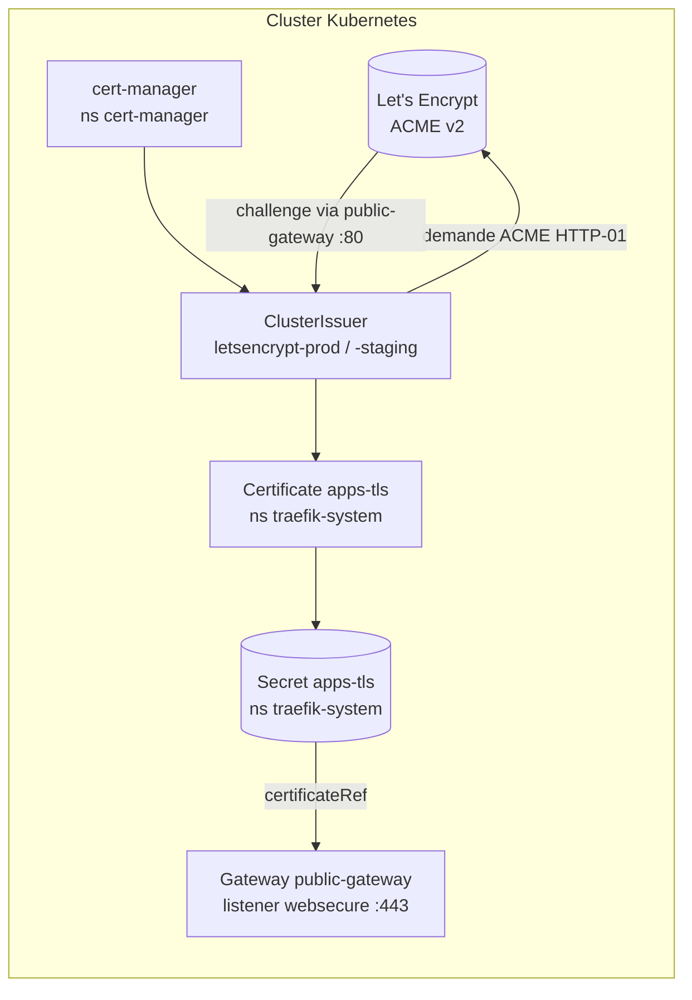

# cert-manager — Certificats TLS (HTTPS Let's Encrypt)

`cert-manager` automatise l'**émission et le renouvellement** des certificats TLS du cluster. Dans KubeQuest, il fournit le **certificat HTTPS** que Traefik présente sur le port **443**, obtenu auprès de **Let's Encrypt** via le challenge **ACME HTTP-01**.

> Sans cert-manager, Traefik n'expose que du HTTP (port 80). Avec cert-manager, tout le trafic est servi en **HTTPS** (le port 80 ne sert plus qu'à la **redirection** et au **challenge ACME**). Vue d'ensemble du routage : [docs/traefik-architecture.md](traefik-architecture.md).

## Architecture



1. `cert-manager` (CRDs + contrôleur) observe les ressources `Certificate`.
2. Le `Certificate` **apps-tls** référence un `ClusterIssuer` (`letsencrypt-prod`).
3. Le `ClusterIssuer` lance un challenge **ACME HTTP-01** : cert-manager crée temporairement une `HTTPRoute` `/.well-known/acme-challenge/...` attachée au **`public-gateway`** (port 80). Let's Encrypt vérifie le challenge, puis émet le certificat.
4. cert-manager écrit le certificat dans le **Secret `apps-tls`** (namespace `traefik-system`).
5. Le listener **`websecure`** du Gateway référence ce Secret (`tls.certificateRefs`) et sert le HTTPS sur le port 443.

## Composants

| Élément | Rôle | Localisation |
| ------- | ---- | ------------ |
| Chart Helm cert-manager | Contrôleur + CRDs (`installCRDs: true`, `enableGatewayAPI: true`) | `oci://quay.io/jetstack/charts/cert-manager` (`v1.20.2`), ns `cert-manager` |
| `ClusterIssuer` `letsencrypt-prod` | Émetteur ACME **production** (certificats reconnus) | [`infra/cert-manager/clusterissuer-letsencrypt-prod.yaml`](../infra/cert-manager/clusterissuer-letsencrypt-prod.yaml) |
| `ClusterIssuer` `letsencrypt-staging` | Émetteur ACME **staging** (tests, hors quota prod) | [`infra/cert-manager/clusterissuer-letsencrypt-staging.yaml`](../infra/cert-manager/clusterissuer-letsencrypt-staging.yaml) |
| `Certificate` `apps-tls` | Certificat **multi-SAN** signé par `letsencrypt-prod` | [`infra/cert-manager/certificate-wildcard.yaml`](../infra/cert-manager/certificate-wildcard.yaml) |
| `Secret` `apps-tls` | Certificat + clé privée générés (consommés par le Gateway) | ns `traefik-system` (créé par cert-manager) |
| Config Helm | `installCRDs`, `enableGatewayAPI: true` | [`infra/cert-manager/values.yaml`](../infra/cert-manager/values.yaml) |

> La config (values + ClusterIssuers + Certificate) vit dans `infra/cert-manager/` **source unique, statique**, appliquée à l'identique par Ansible et consommable par ArgoCD (même modèle que Dex, monitoring, sealed-secrets).

## ClusterIssuers (Let's Encrypt)

Deux émetteurs ACME sont définis, tous deux résolvant le challenge **HTTP-01 via la Gateway API** (solver `gatewayHTTPRoute` pointant sur le `public-gateway`) :

| ClusterIssuer | Serveur ACME | Usage |
| ------------- | ------------ | ----- |
| `letsencrypt-prod` | `https://acme-v02.api.letsencrypt.org/directory` | Production certificats reconnus par les navigateurs |
| `letsencrypt-staging` | `https://acme-staging-v02.api.letsencrypt.org/directory` | Tests **non reconnus** mais sans quota strict |

```yaml
spec:
  acme:
    server: https://acme-v02.api.letsencrypt.org/directory
    email: t-clo-902-nan-1@epitech.eu
    privateKeySecretRef:
      name: letsencrypt-prod-account-key
    solvers:
      - http01:
          gatewayHTTPRoute:
            parentRefs:
              - name: public-gateway
                namespace: traefik-system
                kind: Gateway
```

> ⚠️ Let's Encrypt **prod** applique des quotas (≈ 5 certificats identiques / semaine). Pour itérer sur la configuration, basculer le `Certificate` sur `letsencrypt-staging` (`issuerRef.name`), puis revenir à `letsencrypt-prod` une fois validé.

## Certificate (apps-tls)

Le certificat couvre **tous les hostnames `nip.io`** exposés par le cluster (un seul certificat multi-SAN, partagé par toutes les `HTTPRoute`) :

```yaml
spec:
  secretName: apps-tls
  issuerRef:
    name: letsencrypt-prod
    kind: ClusterIssuer
  dnsNames:
    - "15-237-15-14.nip.io"
    - "app.15-237-15-14.nip.io"
    - "headlamp.15-237-15-14.nip.io"
    - "grafana.15-237-15-14.nip.io"
    - "dex.15-237-15-14.nip.io"
```

> Les `dnsNames` sont **codés en dur** sur l'IP publique du master (`15-237-15-14`). Si l'IP change, mettre à jour `infra/cert-manager/certificate-wildcard.yaml` **et** les hostnames des `HTTPRoute`. (Le nom de fichier `certificate-wildcard.yaml` est historique : il s'agit en réalité d'une liste de SAN explicites, pas d'un wildcard `*.nip.io`.)

## Intégration avec Traefik

Le listener `websecure` du `public-gateway` référence le Secret `apps-tls` et termine le TLS :

```yaml
- name: websecure
  protocol: HTTPS
  port: 443
  tls:
    mode: Terminate
    certificateRefs:
      - kind: Secret
        name: apps-tls
```

La redirection **HTTP → HTTPS** est assurée par l'`HTTPRoute` `redirect-https` ([`infra/traefik/httproute-redirect-https.yaml`](../infra/traefik/httproute-redirect-https.yaml)), attachée au listener `web` (port 80), qui renvoie un **301** vers `https://`. Les `HTTPRoute` de
challenge ACME (`/.well-known/acme-challenge/...`) créées par cert-manager ont un path plus spécifique et **priment** sur ce catch-all (précédence Gateway API), ce qui permet le renouvellement automatique sans casser la redirection.

## Déploiement (Ansible)

Le rôle `cert_manager` est déployé sur le **master**. Il est inclus dans `deploy_all.yml` **après Traefik** (le solver ACME a besoin du `public-gateway`) et **avant** Dex/monitoring/Headlamp (qui servent en HTTPS).

```bash
cd ansible

# Tout cert-manager (install Helm + ClusterIssuers + Certificate)
ansible-playbook -i ansible/inventory.yml ansible/deploy_all.yml --tags cert-manager

# Étapes séparées si besoin
ansible-playbook -i ansible/inventory.yml ansible/deploy_all.yml --tags cert-manager-install   # Helm + CRDs
ansible-playbook -i ansible/inventory.yml ansible/deploy_all.yml --tags cert-manager-deploy    # ClusterIssuers + Certificate

# Playbooks dédiés équivalents
ansible-playbook -i ansible/inventory.yml ansible/install_cert_manager.yml
ansible-playbook -i ansible/inventory.yml ansible/deploy_cert_manager.yml
```

Étapes du rôle :

1. **`install.yml`** copie `infra/cert-manager/` sur le master, installe le chart Helm
   `cert-manager` (`v1.20.2`, `installCRDs: true`, `enableGatewayAPI: true`) dans le namespace
   `cert-manager`, puis attend le rollout du Deployment.
2. **`deploy.yml`** applique `kubectl apply -k infra/cert-manager/` (les deux `ClusterIssuer` + le
   `Certificate apps-tls`), attend que `certificate/apps-tls` passe `Ready` (timeout 5 min), et liste
   les `ClusterIssuer`.

### Paramètres (`roles/cert_manager/defaults/main.yml`)

| Variable | Valeur par défaut |
| -------- | ----------------- |
| `cert_manager_namespace` | `cert-manager` |
| `cert_manager_chart_repo` | `oci://quay.io/jetstack/charts/cert-manager` |
| `cert_manager_chart_version` | `v1.20.2` |
| `cert_manager_letsencrypt_email` | `t-clo-902-nan-1@epitech.eu` |
| `cert_manager_kustomize_src` | `infra/cert-manager` |

## Vérification

Sur le master :

```bash
export KUBECONFIG=/etc/kubernetes/admin.conf

# Contrôleur en marche
kubectl get pods -n cert-manager

# Émetteurs prêts (READY = True)
kubectl get clusterissuer

# Certificat émis et Secret généré
kubectl get certificate -n traefik-system apps-tls
kubectl get secret -n traefik-system apps-tls

# Détail / progression de l'émission
kubectl describe certificate -n traefik-system apps-tls
```

Depuis l'extérieur (chaîne TLS servie par Traefik) :

```bash
curl -vI https://grafana.15-237-15-14.nip.io 2>&1 | grep -Ei 'issuer|subject|HTTP/'
```

## Dépannage

| Symptôme | Piste |
| -------- | ----- |
| `Certificate apps-tls` reste `False` / `Issuing` | Le challenge ACME HTTP-01 doit passer par le port **80** : vérifier que le `public-gateway` est `Programmed` et que le **port 80 est ouvert** dans le Security Group AWS. `kubectl describe certificaterequest,order,challenge -n traefik-system`. |
| `urn:ietf:params:acme:error:rateLimited` | Quota Let's Encrypt **prod** atteint : basculer temporairement le `Certificate` sur `letsencrypt-staging`. |
| Navigateur : certificat **non reconnu** | Le `Certificate` pointe sur `letsencrypt-staging` : repasser `issuerRef.name` sur `letsencrypt-prod`. |
| `ClusterIssuer` `False` (`account registration`) | Vérifier l'email ACME et l'accès réseau sortant du contrôleur vers l'API Let's Encrypt. |
| HTTPS KO après changement d'IP master | Mettre à jour les `dnsNames` de `certificate-wildcard.yaml` et les hostnames des `HTTPRoute`, puis réappliquer. |

Voir aussi : [Traefik architecture](traefik-architecture.md), [Monitoring](monitoring.md), [Dex IDP](dex.md), [Headlamp](headlamp.md).
