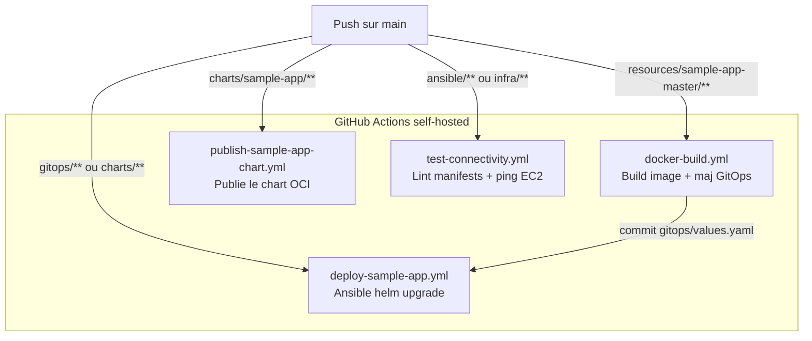

# CI/CD — GitHub Actions

Le dépôt utilise **4 workflows GitHub Actions** (dossier [`.github/workflows/`](../.github/workflows/)), tous exécutés sur un **runner `self-hosted`**. Ils couvrent : build de l'image, publication du chart Helm, déploiement GitOps de l'application, et validation/connectivité de l'infrastructure.

> Le **flux de déploiement applicatif** (build → GitOps → Helm) est aussi décrit côté concepts dans [`docs/deployment-flow.md`](deployment-flow.md) et [`docs/gitops.md`](gitops.md). Ce document-ci est la **référence des workflows** eux-mêmes.

## Vue d'ensemble

## 1. `docker-build.yml` — Build de l'image

**Déclencheurs** : push sur **n'importe quelle branche** modifiant `resources/sample-app-master/**`, ou `workflow_dispatch` (input `branch`).

**Permissions** : `contents: read`, `packages: write`.

### Job `build`
- Login GHCR (`github.actor` / `GITHUB_TOKEN`).
- Build **multi-architecture** (`linux/amd64,linux/arm64`) via Buildx + QEMU.
- Le Dockerfile est **multi-stage** : deux cibles sont publiées
  - `target: production` → image principale ;
  - `target: rollback-demo` → image de démonstration de rollback.
- **Stratégie de tag** :

  | Branche | Image production | Image rollback |
  | ------- | ---------------- | -------------- |
  | `main` | `…/sample-app:<sha12>` | `…/sample-app:rollback-demo` |
  | autre | `…/sample-app:<sha12>` | `…/sample-app:<sha12>-rollback-demo` |

  Base d'image : `ghcr.io/<owner>/<repo>/sample-app` (owner/repo en minuscules).

### Job `update-gitops`
- S'exécute **uniquement** sur push `main` (`needs: build`, `permissions: contents: write`).
- Réécrit `gitops/sample-app/values.yaml` avec `image.tag: <sha12>`, `image.pullPolicy: IfNotPresent` et `podAnnotations.kubequest.io/git-sha: "<sha12>"`.
- Commit (`github-actions[bot]`) et push **seulement s'il y a un changement**.

> Ce commit GitOps est ce qui **déclenche** ensuite `deploy-sample-app.yml`. Le changement de `image.tag` (un nouveau SHA12 à chaque build) suffit à provoquer le rollout des pods ; l'annotation `git-sha` apporte une robustesse supplémentaire (rollout garanti même sur un rebuild du même SHA).

## 2. `publish-sample-app-chart.yml` — Publication du chart Helm

**Déclencheurs** : push (toute branche) modifiant `charts/sample-app/**`, ou `workflow_dispatch`.

**Permissions** : `contents: read`, `packages: write`.

### Job `publish`
- Installe Helm, login registry OCI GHCR (`helm registry login ghcr.io`).
- `helm package charts/sample-app` → archive `sample-app-<version>.tgz` (version issue de `charts/sample-app/Chart.yaml`, actuellement **`0.1.0`**).
- `helm push` vers `oci://ghcr.io/<owner>/<repo>/charts`.

Le chart est ensuite consommable en OCI (voir [`docs/helm.md`](helm.md)) : `oci://ghcr.io/epitechmscpropromo2026/t-clo-902-nan_1/charts/sample-app`.

## 3. `deploy-sample-app.yml` — Déploiement GitOps

**Déclencheurs** : `workflow_dispatch`, ou push `main` modifiant `gitops/sample-app/**`, `charts/sample-app/**`, `ansible/deploy_app.yml`, ou le workflow lui-même.

**Environnement** : `deployment` · **Permissions** : `contents: read`, `packages: read`.

### Job `deploy`
1. Installe Ansible (`apt`).
2. Écrit la clé SSH depuis `secrets.EC2_SSH_KEY` dans `~/.ssh/kubequest.pem` (chmod 600).
3. `ansible-playbook -i ansible/inventory.yml ansible/deploy_app.yml` avec :
   - `ANSIBLE_CONFIG=ansible/ansible.cfg`
   - `GITHUB_USER=github.actor`, `GITHUB_TOKEN=secrets.GITHUB_TOKEN` (création du secret `ghcr-registry` pour le pull d'image).

## 4. `test-connectivity.yml` — Validation & connectivité

**Nom affiché** : *CI - Validate and deploy infrastructure*.

**Déclencheurs** : `workflow_dispatch`, `pull_request` et `push` sur `main` modifiant `ansible/**`, `infra/**`, ou le workflow.

### Job `validate` (toujours)
- `kubectl kustomize infra/headlamp/` valide les manifests Kustomize.
- `ansible-playbook … test_connectivity.yml --syntax-check` valide la syntaxe Ansible.

### Job `aws` (hors pull_request)
- `needs: validate`, environnement `deployment`, condition `github.event_name != 'pull_request'`.
- Écrit `secrets.EC2_SSH_KEY`, puis exécute `test_connectivity.yml` contre les EC2 réelles.

> Sur une **pull request**, seul `validate` tourne (lint/syntaxe, sans accès aux serveurs).
> Le test réel sur EC2 ne s'exécute que sur `push main` ou déclenchement manuel.

## Secrets & environnements requis

| Secret / variable | Où | Usage |
| ----------------- | -- | ----- |
| `EC2_SSH_KEY` | environnement GitHub `deployment` | Clé SSH `kubequest.pem` (accès master/bastion) |
| `GITHUB_TOKEN` | fourni par Actions | Login GHCR (push image/chart, pull au déploiement) |

## Runner self-hosted

Les 4 workflows ciblent `runs-on: self-hosted`. Le runner doit disposer de Docker (Buildx/QEMU), d'un accès réseau à GHCR et aux EC2, et des droits `sudo apt-get` pour installer Ansible/kubectl à la volée.
