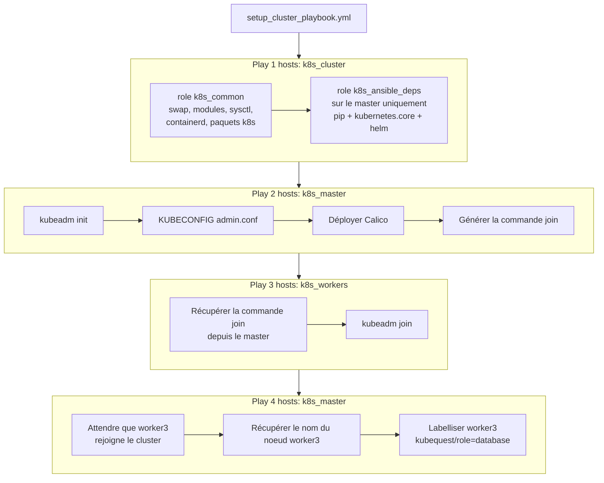

# Provisioning automatisé du cluster Kubernetes (Ansible)

Ce document décrit l'installation **automatisée** du cluster Kubernetes via Ansible (`kubeadm`).
Pour la procédure **manuelle** équivalente (commandes pas à pas), voir [`docs/initialize_vms.md`](initialize_vms.md).

> L'architecture Ansible globale (inventaire, variables, catalogue des rôles/playbooks) est décrite dans [`docs/ansible.md`](ansible.md).

## Vue d'ensemble

Le playbook `setup_cluster_playbook.yml` initialise un cluster `kubeadm` sur Amazon Linux 2023 : un **control-plane** (master) et trois **workers**, avec **containerd** comme runtime et **Calico** comme CNI.



## Lancer le provisioning

Depuis le dossier `ansible/` :

```bash
# Cluster seul
ansible-playbook -i ansible/inventory.yml ansible/setup_cluster_playbook.yml

# Ou via l'orchestrateur complet
ansible-playbook -i ansible/inventory.yml ansible/deploy_all.yml --tags cluster
```

Tags disponibles : `common` (préparation des noeuds), `master`, `worker`, `labels` (labellisation de worker3), `cluster`.

> Toutes les tâches sont **idempotentes** : un noeud déjà initialisé/joint est détecté
> (`/etc/kubernetes/admin.conf` côté master, `/etc/kubernetes/kubelet.conf` côté worker)
> et l'étape correspondante est sautée.

## Détail des rôles

### `k8s_common` (tous les noeuds)

Prépare chaque noeud pour `kubeadm` :

| Étape | Détail |
| ----- | ------ |
| Swap | `swapoff -a` + suppression de l'entrée dans `/etc/fstab` |
| Modules noyau | `br_netfilter`, `overlay` (persistés dans `/etc/modules-load.d/k8s.conf`) |
| Sysctl | `bridge-nf-call-iptables`, `bridge-nf-call-ip6tables`, `ip_forward = 1` (`/etc/sysctl.d/k8s.conf`) |
| Runtime | Installe **containerd**, génère `config.toml`, active **`SystemdCgroup = true`** |
| Paquets | Ajoute le repo `pkgs.k8s.io` (`{{ k8s_version }}` = `v1.35`), installe `kubelet`/`kubeadm`/`kubectl` |
| kubelet | Démarré et activé au boot |

À la fin, le rôle importe `k8s_ansible_deps` **uniquement sur le master** (control-plane).

### `k8s_ansible_deps` (master uniquement)

Installe les prérequis des modules Ansible `kubernetes.core` (utilisés par les playbooks monitoring, headlamp, metrics-server, sealed-secrets) :

- `python3-pip`
- bibliothèques Python : `kubernetes>=28.0.0`, `PyYAML`, `jsonpatch`
- **Helm 3** (via le script officiel `get-helm-3`, seulement s'il est absent)

### `k8s_master` (control-plane)

1. **`kubeadm init`** sans flag particulier (valeurs par défaut : pod CIDR `10.244.0.0/16`).
   Sauté si `/etc/kubernetes/admin.conf` existe déjà.
2. Exporte `KUBECONFIG=/etc/kubernetes/admin.conf` dans `/root/.bashrc`.
3. **Calico** attend l'API server (`127.0.0.1:6443`), puis applique le manifeste `calico.yaml` version `{{ calico_version }}` (`v3.31.4`) s'il n'est pas déjà présent.
   Voir [`docs/cni.md`](cni.md) pour le choix du CNI.
4. **Commande join** génère `kubeadm token create --print-join-command` et la stocke dans un *fact* partagé (`kubeadm_join_command`) pour les workers.
5. Affiche l'état des noeuds et des pods (`kubectl get nodes/pods`).

### `k8s_worker` (workers)

1. Vérifie si le noeud est déjà joint (`/etc/kubernetes/kubelet.conf`).
2. Récupère `kubeadm_join_command` depuis les *hostvars* du master.
3. Exécute la commande **`kubeadm join`** (token à usage unique généré par le master).
4. Exporte `KUBECONFIG=/etc/kubernetes/kubelet.conf` dans `/root/.bashrc`.

> Le `kubelet.conf` des workers offre des droits limités. Pour administrer le cluster, passer par le master (`admin.conf`). Voir la note dans [`docs/initialize_vms.md`](initialize_vms.md).

### Play 4 - "Labelliser les noeuds" (master, tags `labels`, `cluster`)

Une fois les workers joints, un quatrième play (`hosts: k8s_master`) labellise le noeud dédié à la base de données :

1. **Attendre worker3** : boucle (`until`, 30 tentatives, délai 10 s) jusqu'à ce que `worker3_internal_ip` apparaisse dans `kubectl get nodes -o wide`.
2. **Récupérer le nom du noeud** worker3 (via `awk` sur l'IP interne) dans le *fact* `worker3_nodename`.
3. **Labelliser** worker3 avec `kubequest/role=database` (`kubectl label node ... --overwrite`).

## Versions épinglées

Les variables spécifiques à un rôle sont définies dans ses `defaults/main.yml` ; les variables transverses restent dans `group_vars/all.yml` (voir [`docs/ansible.md`](ansible.md)).

| Composant | Variable | Défini dans | Valeur |
| --------- | -------- | ----------- | ------ |
| Kubernetes | `k8s_version` | `roles/k8s_common/defaults` | `v1.35` |
| Runtime | `containerd_config_dir` / `_file` | `roles/k8s_common/defaults` | `containerd` (paquet AL2023) |
| Calico (CNI) | `calico_version` | `roles/k8s_master/defaults` | `v3.31.4` |
| KUBECONFIG master/worker | `k8s_master_config` / `k8s_worker_config` | `group_vars/all.yml` | `admin.conf` / `kubelet.conf` |

## Vérifier le cluster

Sur le master :

```bash
sudo KUBECONFIG=/etc/kubernetes/admin.conf kubectl get nodes -o wide
sudo KUBECONFIG=/etc/kubernetes/admin.conf kubectl get pods -A -o wide
```

Tous les noeuds doivent être `Ready` (après convergence de Calico) et les pods `calico-node` / `coredns` en `Running`.

## Étapes suivantes

Une fois le cluster prêt, le reste de la stack se déploie via `deploy_all.yml` (ou playbook par playbook) : metrics-server -> Sealed Secrets -> Traefik -> monitoring -> Headlamp -> sample-app.
Voir [`docs/ansible.md`](ansible.md) pour l'ordre complet.
