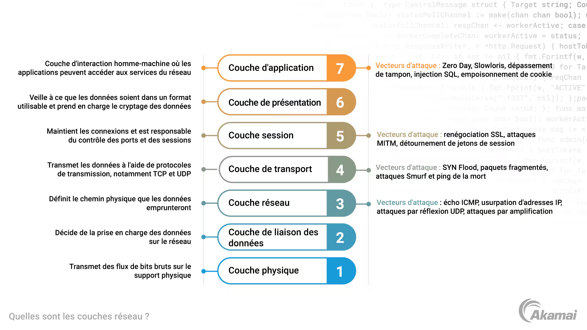

# Comparaison des CNI Kubernetes

Sources 
- https://kubernetes.io/docs/concepts/extend-kubernetes/compute-storage-net/network-plugins/
- https://toungafranck.com/2025/01/01/les-cni-sur-kubernetes/
- https://blog.stephane-robert.info/docs/conteneurs/orchestrateurs/kubernetes/cni-csi-cri/
- https://blog.stephane-robert.info/docs/conteneurs/orchestrateurs/kubernetes/network-policies/
- https://www.tigera.io/learn/guides/cilium-vs-calico/

Le CNI est le gestionnaire du réseau Kubernetes, il permet aux pods de se connecer entre eux mais également aux services externes afin de garantir l'échange d'information rapide et sécurisée sans devoir autoriser plusieurs réseaux et sous-réseaux a communiquer ensemble.
> CNI => Container Network Interface

## CNI populaires
| Nom                                    | Mode                    | Couche    |
| -------------------------------------- | ----------------------- | --------- |
| Calico                                 | BGP/eBFP/VXLAN/IP-in-IP | L3/L4     |
| Flannel                                | VXLAN/Host              | L3        |
| Weave Net (déprécier depuis Juin 2024) | VXLAN/IP-in-IP          | L2/L3     |
| Cilium                                 | eBPF                    | L3/L4/L7  |

## Les avantages
- Calico
    > - Hautement scalable et performant sur des environnements à grande échelle
    > - Network Policies stricte
    > - Optimisation du routage grâce à BGP (Border Gateway Protocol)
    > - Se déploi sur chaque membre d'un cluster
    
- Flannel
    > - Simple d'installation
    > - Idéal pour les environnements à petit échelle
    > - Faible consommation des ressources

- Weave Net
    > - Simple d'installation
    > - Idéal pour les environnements à moyenne échelle

- Cilium
    > - Hautement performant et peu couteux
    > - Network Policies stricte
    > - Interviens sur une couche réseau supplémentaire permettant une observabilité avancée

## Les inconvénients
- Calico
    > - Installation plus compliquer
    > - Peu nécessité des connaissances réseau avancées

- Flannel
    > - Network Policies très limitées
    > - Surconsommation de ressource sur environnements à grande échelle

- Weave Net
    > - Routage BGP peu performant
    > - Network Policies faible

- Cilium
    > - Peut-être complexe selon l'OS
    > - Apprentissage complexe

### Notes
BGP, eBGP et iBGP sont des protocoles de communication réseau généralement utiliser pour échanger des informations en plusieurs routeur peuvent se trouver dans le même réseau interne tant bien que externe..

Protocole populaire chez les opérateurs de télécommunication dans l'objectif de s'inter-connecter.

## Pourquoi nous avons choisi Calico
Pour la réalisation du projet T-CLO-902, nous avons choisi Calico pour se rapprocher d'un environnement d'entreprise à grande échelle.
Celui-ci s'installe sur le maitre mais également sur les membres du cluster Kubernetes, afin de facilité l'administration du réseau de chaque Pod mais aussi la communication entre chaque membre du cluster Kubernetes.
De plus, celui-ci nous permet d'appliquer une politique réseau sticte dans l'objectif de limiter les problèmes d'accès non privilégier.

> Version déployée : **Calico v3.31.4** (variable `calico_version` dans
> [`ansible/roles/k8s_master/defaults/main.yml`](../ansible/roles/k8s_master/defaults/main.yml)),
> installée via le manifeste officiel sur tous les noeuds du cluster.
