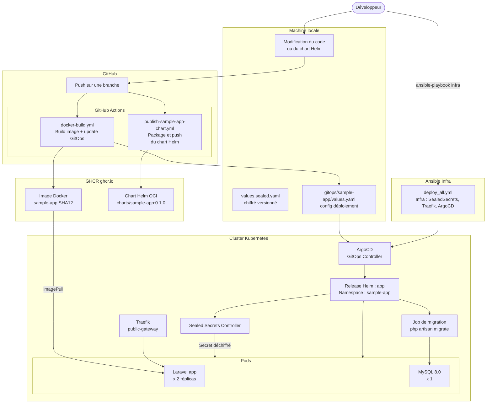
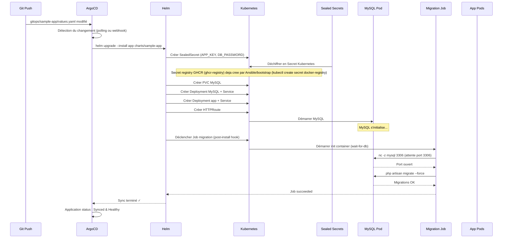

# Flux de déploiement

## CI/CD + GitOps - Publication et déploiement

**Note** : Le workflow `deploy-sample-app.yml` est obsolète. Le déploiement passe maintenant exclusivement par ArgoCD GitOps.

## Ordre des opérations lors d'un sync ArgoCD

