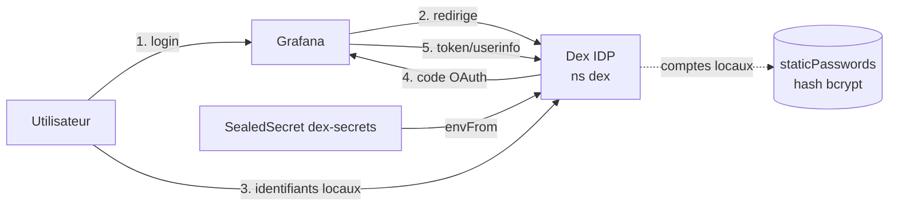

# Dex IDP — Fournisseur d'identité (SSO)

## Objectif

[Dex](https://dexidp.io/) est un fournisseur d'identité **OpenID Connect (OIDC)**. Il sert de
point d'authentification central pour les services du cluster (Grafana, Headlamp) :

- des **comptes locaux** (base de mots de passe statique gérée par Dex) ;
- une fédération **Microsoft Entra ID** (connecteur OIDC).

> **État actuel** : TLS en place (cert-manager / Let's Encrypt). Dex fédère les **comptes locaux**
> + le connecteur **Microsoft Entra ID**, et le **SSO Headlamp** est actif (OIDC + confiance du
> kube-apiserver envers Dex — voir [docs/headlamp.md](headlamp.md#authentification-oidc-via-dex-sso)).

## Grafana et Headlamp via Dex

| Service | Intégration | Détail |
| ------- | ----------- | ------ |
| **Grafana** | OAuth générique → Dex, **actif** | Grafana valide les jetons lui-même. |
| **Headlamp** | OIDC → **actif** | L'OIDC « réel » de Headlamp exige que le **kube-apiserver** fasse confiance à Dex (`--oidc-issuer-url`…). C'est en place depuis le passage en **HTTPS** (cert Let's Encrypt) — voir [docs/headlamp.md](headlamp.md#authentification-oidc-via-dex-sso). |

Le client OAuth `headlamp` est déclaré dans Dex (`config.staticClients`, redirect `/oidc-callback`).

## Architecture



- **Déploiement** : chart Helm `dex/dex`, namespace `dex`, stockage **mémoire** (config 100 %
  statique : clients + comptes), une réplique épinglée sur **worker2** (`nodeSelector` sur le nom
  AWS du node `ip-10-0-3-187.eu-west-3.compute.internal` — à mettre à jour si le node change). La
  config applicative vit dans `infra/dex/values.yaml` ; Ansible se contente de **copier `infra/dex/`
  sur le master** puis de lancer `helm ... -f infra/dex/values.yaml` et `kubectl apply -k`. Le même
  répertoire pourra être consommé tel quel par **ArgoCD** (aucun templating Jinja, hostnames codés
  en dur).
- **Exposition** : HTTPRoute `dex.<nip>` sur le `public-gateway` Traefik existant.
  Émetteur : `http://dex.<nip>` (endpoints `/auth`, `/token`, `/userinfo`, `/keys`,
  `/.well-known/openid-configuration`).
- **Secrets** : hash bcrypt du mot de passe admin + client secrets injectés via le SealedSecret
  `dex-secrets` (envFrom), puis lus **directement** depuis l'environnement avec `hashFromEnv` /
  `secretEnv` (et **non** via l'expansion `$VAR`, qui casserait le `$` du hash bcrypt).

`<nip>` = IP publique du master avec `.` → `-`, suffixé `.nip.io` (ex. `dex.15-237-15-14.nip.io`).

## Composants

| Élément | Rôle | Localisation |
| ------- | ---- | ------------ |
| Rôle Ansible `dex` | Copie `infra/dex/` sur le master puis déploie (Helm + kubectl) | `ansible/roles/dex/` |
| Playbook `deploy_dex.yml` | Orchestration (tag `dex`) | `ansible/deploy_dex.yml` |
| Values Helm | Config Dex (issuer, comptes, clients) — **source unique, statique** | `infra/dex/values.yaml` |
| HTTPRoute | Exposition `dex.<nip>` | `infra/dex/httproute.yaml` |
| SealedSecret `dex-secrets` | Hash bcrypt + client secrets | `infra/dex/dex-sealedsecret.yaml` |
| SealedSecret OAuth Grafana | Client secret côté Grafana | `infra/monitoring/grafana-oauth-sealedsecret.yaml` |
| SealedSecret OIDC Headlamp | Config OIDC côté Headlamp (`OIDC_*`) | `infra/headlamp/headlamp-oidc-sealedsecret.yaml` |

## Mise en place

### 1. Sceller les secrets (sur le master)

On génère **deux** SealedSecrets qui partagent le **même** `GRAFANA_CLIENT_SECRET`. Le scellement
se fait sur le master (kubeseal + accès cluster) ; le mot de passe admin n'y est jamais écrit en
clair (seul son hash bcrypt est scellé).

Prérequis : `kubeseal`, `openssl`, `python3`+`bcrypt`, et le certificat (clé publique) du
contrôleur Sealed Secrets — voir [docs/sealed-secrets.md](sealed-secrets.md).

```bash
export KUBECONFIG=/etc/kubernetes/admin.conf
CERT=/tmp/sealed-secret.pem            # clé publique extraite du contrôleur

# Mot de passe admin Dex -> hash bcrypt (saisie masquée)
read -s -p "Mot de passe admin Dex : " PW; echo
ADMIN_HASH=$(PW="$PW" python3 -c "import bcrypt,os;print(bcrypt.hashpw(os.environ['PW'].encode(),bcrypt.gensalt(10)).decode())")

# Mot de passe user Dex -> hash bcrypt (saisie masquée)
read -s -p "Mot de passe admin Dex : " PW; echo
USER_HASH=$(PW="$PW" python3 -c "import bcrypt,os;print(bcrypt.hashpw(os.environ['PW'].encode(),bcrypt.gensalt(10)).decode())")

# Client secrets OAuth (même valeur Grafana des deux côtés)
GRAFANA_CLIENT_SECRET=$(openssl rand -hex 24)
HEADLAMP_CLIENT_SECRET=$(openssl rand -hex 24)

# SealedSecret dex-secrets (ns dex)
kubectl create secret generic dex-secrets -n dex \
  --from-literal=ADMIN_PASSWORD_HASH="$ADMIN_HASH" \
  --from-literal=USER_PASSWORD_HASH="$USER_HASH" \
  --from-literal=GRAFANA_CLIENT_SECRET="$GRAFANA_CLIENT_SECRET" \
  --from-literal=HEADLAMP_CLIENT_SECRET="$HEADLAMP_CLIENT_SECRET" \
  --dry-run=client -o yaml \
  | kubeseal --format=yaml --cert "$CERT" --scope strict \
  > /tmp/dex-sealedsecret.yaml

# SealedSecret grafana-oauth-credentials (ns monitoring, MÊME secret Grafana)
kubectl create secret generic grafana-oauth-credentials -n monitoring \
  --from-literal=GF_AUTH_GENERIC_OAUTH_CLIENT_SECRET="$GRAFANA_CLIENT_SECRET" \
  --dry-run=client -o yaml \
  | kubeseal --format=yaml --cert "$CERT" --scope strict \
  > /tmp/grafana-oauth-sealedsecret.yaml
```

> **Variante sans fichier cert** (kubeseal interroge le contrôleur live, garantit la clé
> publique active) : remplacer `--cert "$CERT"` par
> `--controller-name sealed-secrets-controller --controller-namespace kube-system`.

Les deux fichiers produits sont chiffrés (**sûrs à committer**). Les placer dans le dépôt puis :

```bash
git add infra/dex/dex-sealedsecret.yaml infra/monitoring/grafana-oauth-sealedsecret.yaml
```

> ⚠️ Le `SealedSecret` doit être scellé avec la **clé publique active** du contrôleur du cluster
> cible. Un cert périmé / d'un autre cluster donne `no key could decrypt secret` au déploiement.

### 2. Déployer

```bash
cd ansible
ansible-playbook -i inventory.yml deploy_all.yml --tags dex,monitoring
# ou playbook dédié :
ansible-playbook -i inventory.yml deploy_dex.yml
```

Ordre dans `deploy_all.yml` : … → `gateway` (Traefik) → **`dex`** → `monitoring` → `headlamp` → `app`.
Dex est déployé **avant** monitoring pour être disponible au démarrage de Grafana.

### 3. Se connecter à Grafana via Dex

1. Ouvrir `http://grafana.<nip>`.
2. Cliquer sur **« Sign in with Dex »**.
3. Saisir `admin@kubequest.local` + le mot de passe scellé à l'étape 1.
4. Arrivée dans Grafana avec le rôle **Admin**.

> **Accès de secours (break-glass)** : le formulaire de connexion admin natif de Grafana reste
> actif (identifiants de `grafana-admin-credentials`). Utile si Dex est indisponible.

## Comptes locaux

Deux comptes locaux sont définis dans `infra/dex/values.yaml` (`config.staticPasswords`) ; leur **mot de passe**
n'existe que sous forme de **hash bcrypt** dans le SealedSecret `dex-secrets` (clés
`ADMIN_PASSWORD_HASH` / `USER_PASSWORD_HASH`, lues via `hashFromEnv`) :

| Compte | Email | Rôle Grafana |
| ------ | ----- | ------------ |
| Admin | `admin@kubequest.local` | **Admin** (email correspondant à `role_attribute_path`) |
| User | `user@kubequest.local` | **Viewer** (par défaut) |

### Ajouter un compte local

1. Ajouter une entrée dans `config.staticPasswords` de
   `infra/dex/values.yaml` (email, `username`, `userID` unique, et
   `hashFromEnv: BOB_PASSWORD_HASH` pointant vers une nouvelle clé d'env).
2. Ajouter la clé `BOB_PASSWORD_HASH` (hash bcrypt) au SealedSecret `dex-secrets`. Le plus simple
   pour n'ajouter qu'une clé sans retoucher les autres est `kubeseal --merge-into` :
   ```bash
   HASH=$(PW="$PW" python3 -c "import bcrypt,os;print(bcrypt.hashpw(os.environ['PW'].encode(),bcrypt.gensalt(10)).decode())")
   kubectl create secret generic dex-secrets -n dex \
     --from-literal=BOB_PASSWORD_HASH="$HASH" --dry-run=client -o yaml \
     | kubeseal --format=yaml --scope strict \
         --controller-name sealed-secrets-controller --controller-namespace kube-system \
         --merge-into infra/dex/dex-sealedsecret.yaml
   ```
3. Re-déployer : `ansible-playbook -i inventory.yml deploy_dex.yml`.

### Mapping des rôles Grafana

Les comptes locaux Dex (`enablePasswordDB`) **n'émettent pas** de claim `groups`. Le rôle Grafana
est donc déterminé **par email**, via `role_attribute_path` dans
`infra/monitoring/values.yaml` :

```ini
role_attribute_path = email == 'admin@kubequest.local' && 'Admin' || 'Viewer'
```

→ l'email admin obtient **Admin**, tous les autres comptes **Viewer**. Le mapping par **groupe**
arrivera avec le connecteur Entra ID.

## Connecteur Microsoft Entra ID

Le connecteur Entra ID est défini dans `config.connectors` de `infra/dex/values.yaml`. Il fédère
les comptes du tenant Microsoft **en plus** des comptes locaux (les deux méthodes coexistent sur la
page de login Dex).

```yaml
connectors:
  - type: oidc
    id: microsoft
    name: Microsoft
    config:
      issuer: "https://login.microsoftonline.com/<tenant-id>/v2.0"
      clientID: "<application-client-id>"
      clientSecret: $MICROSOFT_CLIENT_SECRET
      redirectURI: "https://dex.<nip>/callback"
      scopes: [openid, profile, email]
      insecureSkipEmailVerified: true
      getUserInfo: false
```

### Pourquoi `type: oidc` et non `type: microsoft` ?

Dex propose deux connecteurs pour Entra ID. On utilise volontairement le connecteur **générique `oidc`** plutôt que le connecteur natif **`microsoft`** :

| | `type: microsoft` | `type: oidc` (**retenu**) |
| --- | --- | --- |
| Source des claims | Appelle **Microsoft Graph** (`/me`) pour récupérer profil + email | Lit uniquement l'**ID token** renvoyé par Entra |
| Permissions demandées | `User.Read` (Graph délégué) + OpenID | Seulement OpenID (`openid profile email`) |
| Consentement | **Admin requis** sur notre tenant | User-consentable (si le tenant l'autorise) |
| Groupes Entra natifs | Oui (via `GroupMember.Read.All`) | Non (claim `groups` à configurer côté Entra) |

**Raison déterminante** : notre tenant restreint le consentement utilisateur. Le connecteur
`microsoft` demande la permission Graph `User.Read`, ce qui déclenche une **demande de consentement
administrateur** (message *« Votre administrateur a reçu une notification de votre demande
d'accès… »*) et **bloque la connexion** tant qu'un admin n'a pas approuvé — or nous n'avons pas
d'accès admin garanti sur ce tenant. Le connecteur `oidc` ne demande que les permissions **OpenID de
base**, sans aucun appel Graph, ce qui maximise les chances de passer **sans intervention admin**.

> Si le tenant bloque **tout** consentement utilisateur (y compris OpenID de base), la connexion
> retombera sur la demande admin malgré tout — mais c'est alors un consentement trivial à accorder
> (permissions minimales), et aucune config Dex ne peut le contourner.

### Détails de configuration

- **`issuer` tenant-scopé** (`.../<tenant-id>/v2.0`) : restreint le login aux comptes de **ce
  tenant** (équivalent du champ `tenant:` du connecteur `microsoft`).
- **`insecureSkipEmailVerified: true`** : Entra v2.0 n'émet pas le claim `email_verified` ; sans ça
  Dex rejetterait l'email.
- **`getUserInfo: false`** : les claims viennent de l'ID token, pas du endpoint UserInfo.
- **Claim `email` à activer côté Entra** : Entra v2.0 **n'émet pas `email` par défaut** dans l'ID
  token. Côté App Registration → **Token configuration → Add optional claim → ID → `email`**. Sans
  cet *optional claim*, Dex échoue au retour (`email claim not found`). Repli possible : mapper sur
  `preferred_username` (l'UPN) si aucun email n'est disponible.
- **Secret** : `$MICROSOFT_CLIENT_SECRET` est étendu depuis l'environnement (le connecteur `oidc`
  n'a pas de champ `secretEnv:` comme les `staticClients`). La clé est ajoutée au SealedSecret
  `dex-secrets` (cf. [Ajouter un compte local](#ajouter-un-compte-local) pour le `kubeseal
  --merge-into`, avec `--from-literal=MICROSOFT_CLIENT_SECRET=…`).

### Revenir au connecteur `microsoft`

Pertinent uniquement si l'on veut récupérer les **groupes Entra nativement** (pour mapper les rôles
Grafana par groupe AD) **et** qu'on dispose d'un accès admin pour accorder le consentement
(`User.Read` + `GroupMember.Read.All`). Dans ce cas, remplacer le bloc par `type: microsoft` avec
`tenant:`, `clientID`, `clientSecret`, `redirectURI`, et `groups`/`useGroupsAsWhitelist` au besoin.

## Vérification

```bash
# Dex en marche
kubectl get pods -n dex
kubectl get httproute -n dex          # doit être Accepted par le public-gateway

# Secret déchiffré par Sealed Secrets
kubectl get secret dex-secrets -n dex
kubectl get secret grafana-oauth-credentials -n monitoring

# Discovery OIDC (depuis le master ou un poste pouvant résoudre nip.io)
curl -s http://dex.<nip>/.well-known/openid-configuration | jq .issuer
```

## Dépannage

| Symptôme | Piste |
| -------- | ----- |
| Pod Dex en `CrashLoopBackOff` | Variables d'env manquantes → vérifier que `dex-secrets` est bien déchiffré (`kubectl get secret -n dex`) avant le démarrage. |
| Dex : `malformed bcrypt hash: ... too short` | Le hash bcrypt a été passé via l'expansion `$VAR` (les `$` du hash sont cassés). Utiliser `hashFromEnv:` (et `secretEnv:` pour les clients), pas `hash:`/`secret:` avec `$VAR`. |
| Grafana : « login.OAuthLogin(missing saved state) » ou redirect KO | Vérifier que `redirectURIs` du client `grafana` correspond exactement à `http://grafana.<nip>/login/generic_oauth`. |
| Grafana : timeout sur `token_url`/`api_url` | **Hairpin réseau** : le pod Grafana (worker1) n'atteint pas l'IP publique du master. Repli : pointer `token_url`/`api_url` sur le service interne `http://dex.dex.svc.cluster.local:5556/token|/userinfo` (laisser `auth_url` public). |

## Phase TLS (Entra ID + Headlamp) — réalisée

Avec cert-manager / TLS en place :

1. **Dex en HTTPS** ✅ : émetteur `https://dex.<nip>`, certificat Let's Encrypt prod (Gateway
   Traefik), `redirectURIs` et URLs OAuth Grafana en `https`.
2. **Connecteur Microsoft Entra ID** ✅ : `connectors:` de type `oidc` dans la config Dex (cf.
   [Connecteur Microsoft Entra ID](#connecteur-microsoft-entra-id)).
3. **Headlamp OIDC** ✅ : flags `--oidc-*` posés sur le kube-apiserver, `config.oidc` activé dans le
   chart Headlamp (client `headlamp`), et RBAC mappé sur l'email (`admin@kubequest.local` →
   `cluster-admin`, `user@kubequest.local` → `headlamp-viewer`). Détails et procédure de scellement
   dans [docs/headlamp.md](headlamp.md#authentification-oidc-via-dex-sso).

Voir aussi : [Sealed Secrets](sealed-secrets.md), [Monitoring](monitoring.md), [Headlamp](headlamp.md).
