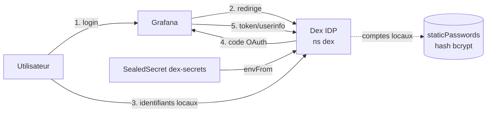

# Dex IDP — Fournisseur d'identité (SSO)

## Objectif

[Dex](https://dexidp.io/) est un fournisseur d'identité **OpenID Connect (OIDC)**. Il sert de
point d'authentification central pour les services du cluster (Grafana, Headlamp), avec à terme :

- des **comptes locaux** (base de mots de passe statique gérée par Dex) ;
- une fédération **Microsoft Entra ID** (connecteur OIDC) — **à venir**.

> ⚠️ **État actuel (étape 1)** : **comptes locaux uniquement**. Le connecteur Microsoft Entra ID
> et le SSO complet de Headlamp seront ajoutés **avec cert-manager / TLS** (voir
> [« À faire en phase TLS »](#à-faire-en-phase-tls-entra-id--headlamp)).

## Pourquoi Grafana maintenant, mais pas Headlamp ?

| Service | Intégration | Pourquoi |
| ------- | ----------- | -------- |
| **Grafana** | OAuth générique → Dex, **actif** | Grafana valide les jetons lui-même : fonctionne en HTTP. |
| **Headlamp** | OIDC → **différé** | L'OIDC « réel » de Headlamp exige que le **kube-apiserver** fasse confiance à Dex (`--oidc-issuer-url`…), or l'apiserver **refuse un émetteur en HTTP**. Il faut donc TLS d'abord. |

Le client OAuth `headlamp` est **déjà déclaré** dans Dex, prêt à être activé une fois le TLS en place.

## Architecture



- **Déploiement** : chart Helm `dex/dex`, namespace `dex`, stockage **mémoire** (config 100 %
  statique : clients + comptes), une réplique.
- **Exposition** : HTTPRoute `dex.<nip>` sur le `public-gateway` Traefik existant.
  Émetteur : `http://dex.<nip>` (endpoints `/auth`, `/token`, `/userinfo`, `/keys`,
  `/.well-known/openid-configuration`).
- **Secrets** : hash bcrypt du mot de passe admin + client secrets injectés via le SealedSecret
  `dex-secrets` (envFrom), puis lus **directement** depuis l'environnement avec `hashFromEnv` /
  `secretEnv` (et **non** via l'expansion `$VAR`, qui casserait le `$` du hash bcrypt).

`<nip>` = IP publique du master avec `.` → `-`, suffixé `.nip.io` (ex. `dex.15-237-15-14.nip.io`).

## Composants

| Élément | Rôle | Localisation |
| ------- | ---- | ------------ |
| Rôle Ansible `dex` | Déploie Dex (Helm) + HTTPRoute | `ansible/roles/dex/` |
| Playbook `deploy_dex.yml` | Orchestration (tag `dex`) | `ansible/deploy_dex.yml` |
| Values Helm | Config Dex (issuer, comptes, clients) | `ansible/roles/dex/templates/values.yaml.j2` |
| HTTPRoute | Exposition `dex.<nip>` | `infra/dex/httproute.yaml` |
| SealedSecret `dex-secrets` | Hash bcrypt + client secrets | `infra/dex/dex-sealedsecret.yaml` |
| SealedSecret OAuth Grafana | Client secret côté Grafana | `infra/monitoring/grafana-oauth-sealedsecret.yaml` |

## Mise en place

### 1. Sceller les secrets (sur le master)

On génère **deux** SealedSecrets qui partagent le **même** `GRAFANA_CLIENT_SECRET`. Le scellement
se fait sur le master (kubeseal + accès cluster) ; le mot de passe admin n'y est jamais écrit en
clair (seul son hash bcrypt est scellé).

Prérequis : `kubeseal`, `openssl`, `python3`+`bcrypt`, et le certificat (clé publique) du
contrôleur Sealed Secrets — voir [docs/sealed-secrets.md](sealed-secrets.md).

```bash
export KUBECONFIG=/etc/kubernetes/admin.conf
CERT=/tmp/sealed-secret.pem            # clé publique extraite du contrôleur

# Mot de passe admin Dex -> hash bcrypt (saisie masquée)
read -s -p "Mot de passe admin Dex : " PW; echo
ADMIN_HASH=$(PW="$PW" python3 -c "import bcrypt,os;print(bcrypt.hashpw(os.environ['PW'].encode(),bcrypt.gensalt(10)).decode())")

# Mot de passe user Dex -> hash bcrypt (saisie masquée)
read -s -p "Mot de passe admin Dex : " PW; echo
USER_HASH=$(PW="$PW" python3 -c "import bcrypt,os;print(bcrypt.hashpw(os.environ['PW'].encode(),bcrypt.gensalt(10)).decode())")

# Client secrets OAuth (même valeur Grafana des deux côtés)
GRAFANA_CLIENT_SECRET=$(openssl rand -hex 24)
HEADLAMP_CLIENT_SECRET=$(openssl rand -hex 24)

# SealedSecret dex-secrets (ns dex)
kubectl create secret generic dex-secrets -n dex \
  --from-literal=ADMIN_PASSWORD_HASH="$ADMIN_HASH" \
  --from-literal=USER_PASSWORD_HASH="$USER_HASH" \
  --from-literal=GRAFANA_CLIENT_SECRET="$GRAFANA_CLIENT_SECRET" \
  --from-literal=HEADLAMP_CLIENT_SECRET="$HEADLAMP_CLIENT_SECRET" \
  --dry-run=client -o yaml \
  | kubeseal --format=yaml --cert "$CERT" --scope strict \
  > /tmp/dex-sealedsecret.yaml

# SealedSecret grafana-oauth-credentials (ns monitoring, MÊME secret Grafana)
kubectl create secret generic grafana-oauth-credentials -n monitoring \
  --from-literal=GF_AUTH_GENERIC_OAUTH_CLIENT_SECRET="$GRAFANA_CLIENT_SECRET" \
  --dry-run=client -o yaml \
  | kubeseal --format=yaml --cert "$CERT" --scope strict \
  > /tmp/grafana-oauth-sealedsecret.yaml
```

> **Variante sans fichier cert** (kubeseal interroge le contrôleur live, garantit la clé
> publique active) : remplacer `--cert "$CERT"` par
> `--controller-name sealed-secrets-controller --controller-namespace kube-system`.

Les deux fichiers produits sont chiffrés (**sûrs à committer**). Les placer dans le dépôt puis :

```bash
git add infra/dex/dex-sealedsecret.yaml infra/monitoring/grafana-oauth-sealedsecret.yaml
```

> ⚠️ Le `SealedSecret` doit être scellé avec la **clé publique active** du contrôleur du cluster
> cible. Un cert périmé / d'un autre cluster donne `no key could decrypt secret` au déploiement.

### 2. Déployer

```bash
cd ansible
ansible-playbook -i inventory.yml deploy_all.yml --tags dex,monitoring
# ou playbook dédié :
ansible-playbook -i inventory.yml deploy_dex.yml
```

Ordre dans `deploy_all.yml` : … → `gateway` (Traefik) → **`dex`** → `monitoring` → `headlamp` → `app`.
Dex est déployé **avant** monitoring pour être disponible au démarrage de Grafana.

### 3. Se connecter à Grafana via Dex

1. Ouvrir `http://grafana.<nip>`.
2. Cliquer sur **« Sign in with Dex »**.
3. Saisir `admin@kubequest.local` + le mot de passe scellé à l'étape 1.
4. Arrivée dans Grafana avec le rôle **Admin**.

> **Accès de secours (break-glass)** : le formulaire de connexion admin natif de Grafana reste
> actif (identifiants de `grafana-admin-credentials`). Utile si Dex est indisponible.

## Comptes locaux

Deux comptes locaux sont définis dans `ansible/roles/dex/defaults/main.yml` ; leur **mot de passe**
n'existe que sous forme de **hash bcrypt** dans le SealedSecret `dex-secrets` (clés
`ADMIN_PASSWORD_HASH` / `USER_PASSWORD_HASH`, lues via `hashFromEnv`) :

| Compte | Email | Rôle Grafana |
| ------ | ----- | ------------ |
| Admin | `admin@kubequest.local` | **Admin** (email correspondant à `role_attribute_path`) |
| User | `user@kubequest.local` | **Viewer** (par défaut) |

### Ajouter un compte local

1. Ajouter une entrée dans `config.staticPasswords` de
   `ansible/roles/dex/templates/values.yaml.j2` (email, `username`, `userID` unique, et
   `hashFromEnv: BOB_PASSWORD_HASH` pointant vers une nouvelle clé d'env).
2. Ajouter la clé `BOB_PASSWORD_HASH` (hash bcrypt) au SealedSecret `dex-secrets`. Le plus simple
   pour n'ajouter qu'une clé sans retoucher les autres est `kubeseal --merge-into` :
   ```bash
   HASH=$(PW="$PW" python3 -c "import bcrypt,os;print(bcrypt.hashpw(os.environ['PW'].encode(),bcrypt.gensalt(10)).decode())")
   kubectl create secret generic dex-secrets -n dex \
     --from-literal=BOB_PASSWORD_HASH="$HASH" --dry-run=client -o yaml \
     | kubeseal --format=yaml --scope strict \
         --controller-name sealed-secrets-controller --controller-namespace kube-system \
         --merge-into infra/dex/dex-sealedsecret.yaml
   ```
3. Re-déployer : `ansible-playbook -i inventory.yml deploy_dex.yml`.

### Mapping des rôles Grafana

Les comptes locaux Dex (`enablePasswordDB`) **n'émettent pas** de claim `groups`. Le rôle Grafana
est donc déterminé **par email**, via `role_attribute_path` dans
`ansible/roles/monitoring/templates/values.yaml.j2` :

```ini
role_attribute_path = email == 'admin@kubequest.local' && 'Admin' || 'Viewer'
```

→ l'email admin obtient **Admin**, tous les autres comptes **Viewer**. Le mapping par **groupe**
arrivera avec le connecteur Entra ID.

## Vérification

```bash
# Dex en marche
kubectl get pods -n dex
kubectl get httproute -n dex          # doit être Accepted par le public-gateway

# Secret déchiffré par Sealed Secrets
kubectl get secret dex-secrets -n dex
kubectl get secret grafana-oauth-credentials -n monitoring

# Discovery OIDC (depuis le master ou un poste pouvant résoudre nip.io)
curl -s http://dex.<nip>/.well-known/openid-configuration | jq .issuer
```

## Dépannage

| Symptôme | Piste |
| -------- | ----- |
| Pod Dex en `CrashLoopBackOff` | Variables d'env manquantes → vérifier que `dex-secrets` est bien déchiffré (`kubectl get secret -n dex`) avant le démarrage. |
| Dex : `malformed bcrypt hash: ... too short` | Le hash bcrypt a été passé via l'expansion `$VAR` (les `$` du hash sont cassés). Utiliser `hashFromEnv:` (et `secretEnv:` pour les clients), pas `hash:`/`secret:` avec `$VAR`. |
| Grafana : « login.OAuthLogin(missing saved state) » ou redirect KO | Vérifier que `redirectURIs` du client `grafana` correspond exactement à `http://grafana.<nip>/login/generic_oauth`. |
| Grafana : timeout sur `token_url`/`api_url` | **Hairpin réseau** : le pod Grafana (worker1) n'atteint pas l'IP publique du master. Repli : pointer `token_url`/`api_url` sur le service interne `http://dex.dex.svc.cluster.local:5556/token|/userinfo` (laisser `auth_url` public). |

## À faire en phase TLS (Entra ID + Headlamp)

Une fois cert-manager / TLS en place :

1. **Basculer Dex en HTTPS** : émetteur `https://dex.<domaine>`, certificat via cert-manager,
   et mettre à jour les `redirectURIs` + les URLs OAuth de Grafana en `https`.
2. **Connecteur Microsoft Entra ID** : ajouter un `connectors:` de type `microsoft` (ou `oidc`)
   dans la config Dex (tenant, client ID/secret scellés), et basculer le mapping de rôle Grafana
   sur les **groupes** Entra.
3. **Headlamp OIDC** :
   - configurer les flags du kube-apiserver (`--oidc-issuer-url=https://dex.<domaine>`,
     `--oidc-client-id=headlamp`, `--oidc-username-claim`, `--oidc-groups-claim`) ;
   - activer `config.oidc` dans le chart Headlamp (client `headlamp`, déjà déclaré dans Dex) ;
   - définir le RBAC Kubernetes mappé sur les groupes/emails OIDC.

Voir aussi : [Sealed Secrets](sealed-secrets.md), [Monitoring](monitoring.md), [Headlamp](headlamp.md).
