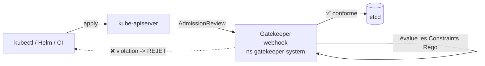

# OPA Gatekeeper - Policy as Code (validating admission webhook)

**OPA Gatekeeper** applique des **règles de gouvernance** au cluster Kubernetes. Il s'enregistre auprès du `kube-apiserver` comme **validating admission webhook** : toute création/modification de ressource est évaluée contre des **politiques** *avant* d'être écrite dans `etcd`. Une ressource non conforme est **refusée** (et n'est jamais créée), avec un message d'erreur explicite.

> Objectif dans KubeQuest : empêcher *techniquement* le déploiement de workloads non conformes dans le namespace applicatif `sample-app` (tag `:latest`, absence de limites de ressources, labels manquants) - plutôt que de seulement le documenter.

## Le mécanisme



- **Validating** : Gatekeeper *valide* (accepte/refuse), il ne modifie pas la ressource.
- **`validatingWebhookFailurePolicy: Ignore`** (nom exact de la cle dans `infra/gatekeeper/values.yaml`, equivalent au `failurePolicy: Ignore` du ValidatingWebhookConfiguration genere) : si le pod Gatekeeper est indisponible, l'admission n'est **pas** bloquée - on évite de "bricker" le cluster.
- En plus de l'admission (préventif), Gatekeeper fait de l'**audit** périodique : il signale les ressources *déjà présentes* qui violeraient une politique (`status.violations`).

## Architecture des politiques

Gatekeeper repose sur deux types de ressources :

| Objet | Rôle |
| ----- | ---- |
| **`ConstraintTemplate`** | Définit *la règle* en **Rego** (logique réutilisable) et génère un nouveau CRD. |
| **`Constraint`** | *Instancie* le template avec des paramètres concrets + une **portée** (`match`). |

```
ConstraintTemplate (K8sDisallowedTags) > CRD k8sdisallowedtags.constraints.gatekeeper.sh
                                                                             │
Constraint (kind: K8sDisallowedTags, name: disallow-latest-tag) ──instancie──┘
```

> ⚠️ Ordre de déploiement : une `Constraint` ne peut être appliquée qu'**après** que le CRD généré par sa `ConstraintTemplate` soit *Established*. Le rôle Ansible gère cette séquence (apply templates -> `kubectl wait --for condition=established` -> apply constraints).

## Composants déployés

| Élément | Rôle | Localisation |
| ------- | ---- | ------------ |
| Chart Helm `gatekeeper` | Contrôleur (webhook) + audit + CRDs | `https://open-policy-agent.github.io/gatekeeper/charts` (`3.22.2`), ns `gatekeeper-system` |
| Values Helm | `replicas: 1`, `validatingWebhookFailurePolicy: Ignore`, exemption `kube-system`/`gatekeeper-system` | [`infra/gatekeeper/values.yaml`](../infra/gatekeeper/values.yaml) |
| `ConstraintTemplate` **K8sDisallowedTags** | Interdit le tag `:latest` / les images sans tag | [`infra/gatekeeper/templates/k8sdisallowedtags.yaml`](../infra/gatekeeper/templates/k8sdisallowedtags.yaml) |
| `ConstraintTemplate` **K8sContainerLimits** | Exige `cpu`+`memory` limits par conteneur | [`infra/gatekeeper/templates/k8scontainerlimits.yaml`](../infra/gatekeeper/templates/k8scontainerlimits.yaml) |
| `ConstraintTemplate` **K8sRequiredLabels** | Exige un jeu de labels | [`infra/gatekeeper/templates/k8srequiredlabels.yaml`](../infra/gatekeeper/templates/k8srequiredlabels.yaml) |
| Constraints (3) | Instances `deny`, portée `sample-app` | [`infra/gatekeeper/constraints/`](../infra/gatekeeper/constraints/) |

## Politiques en vigueur

Toutes les Constraints sont en mode **`enforcementAction: deny`** et **limitées au namespace `sample-app`** (`match.namespaces: [sample-app]`). Aucun composant d'infrastructure (Traefik, Prometheus, cert-manager, Dex, Headlamp...) n'est donc impacté.

| Constraint | Type | Règle | Cible |
| ---------- | ---- | ----- | ----- |
| `disallow-latest-tag` | K8sDisallowedTags | tag `:latest` interdit + tag explicite obligatoire | `Pod` |
| `containers-must-have-limits` | K8sContainerLimits | `resources.limits.cpu` **et** `.memory` obligatoires (conteneurs + init) | `Pod` |
| `workloads-must-have-app-label` | K8sRequiredLabels | label `app.kubernetes.io/name` obligatoire | `Deployment`, `StatefulSet` |

> Le chart `sample-app` est **conforme** à ces trois règles. Deux ajustements ont été faits pour le rester totalement : ajout de `resources` à l'initContainer `wait-for-db` (job de migration) et au conteneur du CronJob de backup MySQL.

## Déploiement

Via l'orchestrateur (placé après Sealed Secrets, avant Traefik) :

```bash
# Tout le bloc Gatekeeper (install chart + politiques)
ansible-playbook -i ansible/inventory.yml ansible/deploy_all.yml --tags gatekeeper

# Ou en deux temps
ansible-playbook -i ansible/inventory.yml ansible/deploy_all.yml --tags gatekeeper-install
ansible-playbook -i ansible/inventory.yml ansible/deploy_all.yml --tags gatekeeper-deploy
```

Playbooks dédiés équivalents :

```bash
ansible-playbook -i ansible/inventory.yml ansible/install_gatekeeper.yml   # chart Helm
ansible-playbook -i ansible/inventory.yml ansible/deploy_gatekeeper.yml    # ConstraintTemplates + Constraints
```

## Vérification / démonstration

```bash
# Les politiques sont actives ?
kubectl get constrainttemplates
kubectl get constraints -A

# ❌ Doit être REFUSÉ (tag latest) :
kubectl run demo --image=nginx:latest -n sample-app
# Error from server (Forbidden): admission webhook "validation.gatekeeper.sh" denied
#   the request: [disallow-latest-tag] conteneur <demo> : le tag d'image <latest> est interdit ...

# ❌ Doit être REFUSÉ (pas de limites) :
kubectl run demo --image=nginx:1.27 -n sample-app
#   [containers-must-have-limits] conteneur <demo> : limites de ressources manquantes : {"cpu", "memory"}

# ✅ Doit être ACCEPTÉ (tag explicite + limites) :
kubectl run demo --image=nginx:1.27 -n sample-app \
  --overrides='{"spec":{"containers":[{"name":"demo","image":"nginx:1.27","resources":{"limits":{"cpu":"100m","memory":"64Mi"}}}]}}'
kubectl delete pod demo -n sample-app
```

Voir les violations détectées par l'audit sur les ressources existantes :

```bash
kubectl get k8scontainerlimits containers-must-have-limits -o jsonpath='{.status.violations}' | jq
```

## Aller plus loin

- **Étendre la portée** : retirer/élargir `match.namespaces` dans une Constraint pour couvrir d'autres namespaces (penser à exempter les namespaces système : `controllerManager.exemptNamespaces` dans les values, ou label `admission.gatekeeper.sh/ignore`).
- **Tester sans bloquer** : passer une Constraint en `enforcementAction: dryrun` (audit seul) ou `warn` (avertissement non bloquant) avant de basculer en `deny`.
- **Bibliothèque de politiques** : [open-policy-agent/gatekeeper-library](https://github.com/open-policy-agent/gatekeeper-library) (templates prêts à l'emploi : privileged, hostPath, readOnlyRootFilesystem, etc.).
