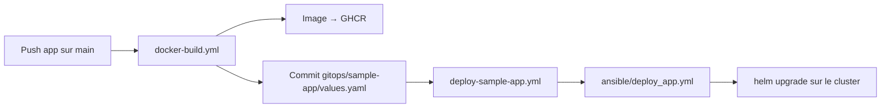

# GitOps (sans ArgoCD)

Le déploiement de `sample-app` est **piloté par Git** : la CI met à jour `gitops/sample-app/values.yaml`, puis déploie automatiquement sur le cluster.

## Flux



1. Tu pushes du code dans `resources/sample-app-master/`
2. La CI build l'image et la pousse sur GHCR
3. La CI met à jour `gitops/sample-app/values.yaml` (annotation `git-sha` → force le rollout)
4. Le push GitOps déclenche `deploy-sample-app.yml`
5. Ansible exécute `helm upgrade` avec :
   - `charts/sample-app/values.sealed.yaml` — secrets chiffrés
   - `gitops/sample-app/values.yaml` — tag image, réplicas, etc.
   - registry GHCR — généré depuis `GITHUB_TOKEN` en CI

## Fichiers clés

| Fichier | Rôle |
|---------|------|
| `gitops/sample-app/values.yaml` | Config de déploiement versionnée (image, annotations) |
| `charts/sample-app/values.sealed.yaml` | Secrets scellés (APP_KEY, DB password) |
| `.github/workflows/deploy-sample-app.yml` | Déploiement auto sur push GitOps / chart |
| `.github/workflows/docker-build.yml` | Build image + mise à jour GitOps |

## Déclencheurs du déploiement

Le workflow `deploy-sample-app.yml` se lance sur :
- push `main` modifiant `gitops/sample-app/**` ou `charts/sample-app/**`
- déclenchement manuel (`workflow_dispatch`)

## Déploiement manuel

```bash
export GITHUB_USER="<github-username>"
export GITHUB_TOKEN="<github-token>"
ansible-playbook -i ansible/inventory.yml ansible/deploy_app.yml
```

## Modifier la config de déploiement

Édite `gitops/sample-app/values.yaml` et push sur `main` :

```yaml
image:
  tag: latest
  pullPolicy: Always

replicaCount: 2

podAnnotations:
  kubequest.io/git-sha: "abc123"
```

La CI met à jour `podAnnotations.kubequest.io/git-sha` à chaque build pour forcer Kubernetes à redéployer les pods même avec `tag: latest`.

## Prérequis CI

L'environnement GitHub `deployment` doit contenir :
- `EC2_SSH_KEY` — clé SSH pour accéder au master Kubernetes

Le `GITHUB_TOKEN` du workflow fournit l'accès au pull GHCR.

## Évolution future

Quand ArgoCD sera ajouté, `gitops/sample-app/values.yaml` restera la source de vérité — seul le mécanisme de sync changera (ArgoCD watch Git au lieu de la CI qui lance Ansible).
