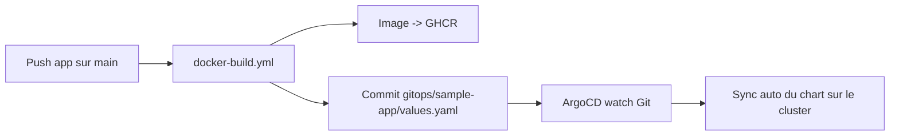

# GitOps (ArgoCD)

Le déploiement de `sample-app` est **piloté par Git** via **ArgoCD** : la CI met à jour `gitops/sample-app/values.yaml`, et ArgoCD surveille Git puis synchronise automatiquement le chart sur le cluster (mode pull).

## Flux



1. Tu pushes du code dans `resources/sample-app-master/`
2. La CI build l'image et la pousse sur GHCR
3. La CI met a jour `gitops/sample-app/values.yaml` (`image.tag` + annotation `git-sha` -> force le rollout)
4. ArgoCD detecte le changement dans Git
5. ArgoCD synchronise le chart `charts/sample-app` avec :
   - `charts/sample-app/values.sealed.yaml` secrets chiffres
   - `gitops/sample-app/values.yaml` tag image, annotations, etc.

## Application ArgoCD

L'`Application` est definie dans `infra/argocd/app-argocd-sample-app.yaml` (objet `argoproj.io/v1alpha1`, enregistre dans `infra/argocd/kustomization.yaml`) :

- **Source** : ce depot, branche `main`, path `charts/sample-app`.
- **Values** : `values.sealed.yaml` puis `../../gitops/sample-app/values.yaml`.
- **Destination** : namespace `sample-app`.
- **syncPolicy.automated** : `prune: true`, `selfHeal: true` (ArgoCD reconcilie en continu et supprime les ressources orphelines).

## Fichiers cles

| Fichier | Role |
|---------|------|
| `gitops/sample-app/values.yaml` | Config de deploiement versionnee (image, annotations) |
| `charts/sample-app/values.sealed.yaml` | Secrets scelles (APP_KEY, DB password) |
| `infra/argocd/app-argocd-sample-app.yaml` | Application ArgoCD (source Git + sync auto) |
| `.github/workflows/docker-build.yml` | Build image + mise a jour GitOps |

## Modifier la config de deploiement

Edite `gitops/sample-app/values.yaml` et push sur `main` ; ArgoCD applique le changement :

```yaml
image:
  tag: "ef1499512d04"      # SHA12 du commit (reecrit par la CI a chaque build)
  pullPolicy: IfNotPresent

podAnnotations:
  kubequest.io/git-sha: "ef1499512d04"
```

La CI reecrit `image.tag` (SHA12 du commit) **et** `podAnnotations.kubequest.io/git-sha` a chaque build : le changement de tag suffit a redeployer les pods, et l'annotation `git-sha` apporte une robustesse supplementaire.

## Synchronisation

ArgoCD surveille Git (polling, ou webhook si configure) et synchronise automatiquement des qu'un changement est detecte sur `charts/sample-app` ou les values. `gitops/sample-app/values.yaml` reste la **source de verite** du tag d'image deploye. Voir aussi [docs/argocd.md](argocd.md).
