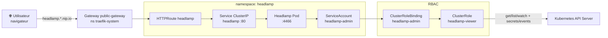
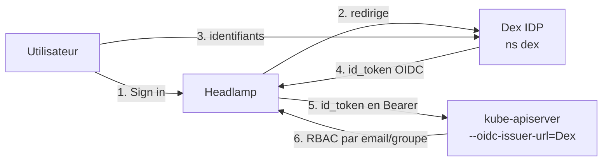

# Headlamp - Tableau de bord Kubernetes

Headlamp est une interface web open-source pour Kubernetes. Elle permet de visualiser et gérer les ressources du cluster (pods, deployments, services, namespaces, logs, etc.) depuis un navigateur.

## Architecture des composants



## Déploiement

Headlamp est déployé via deux mécanismes combinés :

1. **Helm** installe/met à jour le chart officiel Headlamp
2. **Kustomize** applique les ressources complémentaires (ServiceAccount, RBAC, exposition réseau)

> Note : ces commandes sont exécutées sur le **master** (control-plane), car c'est lui qui possède le kubeconfig admin (`/etc/kubernetes/admin.conf`) permettant d'administrer le cluster.

```bash
helm repo add headlamp https://kubernetes-sigs.github.io/headlamp/
helm repo update
helm upgrade --install headlamp headlamp/headlamp \
  -n headlamp --create-namespace \
  -f infra/headlamp/values.yaml
kubectl apply -k infra/headlamp/
```

> Le chart est installé avec `-f infra/headlamp/values.yaml`, qui porte `clusterRoleBinding.create=false` (on utilise le `ClusterRoleBinding`/`ClusterRole` dédiés `headlamp-admin` -> `headlamp-viewer` fournis dans `infra/headlamp/` plutôt que celui du chart), le `nodeSelector` (worker3) et la config OIDC.

### Déploiement via Ansible (recommandé)

Pour automatiser le déploiement sur les instances EC2, on utilise Ansible pour exécuter Helm puis appliquer `infra/headlamp/` sur le host `k8s_master` (jump host + kubeconfig admin).

```bash
cd ansible
ansible-playbook -i ansible/inventory.yml ansible/deploy_headlamp.yml
```

Le playbook force le **Pod** Headlamp sur **worker3** : un `nodeSelector` cible le noeud Kubernetes dont le `kubernetes.io/hostname` est `ip-10-0-3-213.eu-west-3.compute.internal` (worker3), défini dans `infra/headlamp/values.yaml`. Il installe aussi les CRD Gateway API si elles sont absentes, et nettoie les anciennes ressources (ClusterRoleBinding par défaut du chart, ancien Service NodePort) avant d'appliquer les manifests Kustomize.

## Accès via Gateway (recommandé)

Prérequis : Traefik déployé (`install_traefik.yml` + `deploy_traefik.yml`), comme pour Grafana. Le playbook installe au besoin les CRD Gateway API.

Le routage se fait **par hostname** (HTTPRoute dédié, chemin `/`), avec un hostname dérivé de l'IP publique du master via [nip.io](https://nip.io) :

| Service  | URL (depuis Internet)                       |
| -------- | ------------------------------------------- |
| Headlamp | `https://headlamp.<IP_master_tirets>.nip.io/` |

> Exemple avec l'IP `15.237.15.14` : `https://headlamp.15-237-15-14.nip.io/`.

Les ports **TCP 80 et 443** du master doivent être ouverts dans le security group AWS (le 80 redirige vers le 443/HTTPS).

Vérification sur le master :

```bash
sudo KUBECONFIG=/etc/kubernetes/admin.conf kubectl get httproute,pods,svc,endpoints -n headlamp
```

## RBAC

Le `ClusterRoleBinding` attache le ServiceAccount `headlamp-admin` au `ClusterRole` dédié **`headlamp-viewer`** (défini dans `infra/headlamp/clusterrole.yaml`).

Ce rôle accorde principalement `get/list/watch` sur les ressources nécessaires à l'affichage : workloads, services, namespaces, noeuds, RBAC, ingresses, Gateway API, stockage, métriques, etc.

Exceptions pour l'usage courant dans l'UI :

| Ressource | Verbes | Usage |
| --------- | ------ | ----- |
| `secrets` | `get`, `list`, `watch` | Afficher les clés (ex. `APP_KEY` dans `app-sample-app-app-secrets`) |
| `events` | `get`, `list`, `watch`, `delete`, `deletecollection` | Supprimer des events (y compris en masse) |
| `pods/log` | `get`, `list`, `watch` | Consulter les logs des pods |

> Les secrets restent en **lecture seule** (pas de `create`/`update`/`delete`). Après modification du `ClusterRole`, régénère le token Headlamp (voir ci-dessous) pour que les nouvelles permissions s'appliquent.

## Authentification OIDC via Dex (SSO)

Headlamp utilise **Dex** comme fournisseur d'identité OIDC, comme Grafana. La grosse différence : Grafana valide les jetons lui-même, alors que **Headlamp transmet l'`id_token` Dex au kube-apiserver**. L'apiserver doit donc faire **confiance à Dex** (flags `--oidc-*`), sinon le login réussit mais l'API renvoie `401`.



Trois volets, tous gérés par le rôle Ansible `headlamp` :

1. **Chart Headlamp** (`infra/headlamp/values.yaml`) `config.oidc.externalSecret` pointe sur le Secret scellé `headlamp-oidc` (clés `OIDC_CLIENT_ID`, `OIDC_CLIENT_SECRET`, `OIDC_ISSUER_URL`, `OIDC_SCOPES`, `OIDC_CALLBACK_URL`). Le client OAuth `headlamp` est déjà déclaré dans Dex (redirect `/oidc-callback`).
2. **kube-apiserver** la tâche `roles/headlamp/tasks/apiserver-oidc.yml` ajoute de façon idempotente `--oidc-issuer-url=https://dex.<nip>`, `--oidc-client-id=headlamp`, `--oidc-username-claim=email`, `--oidc-groups-claim=groups` au manifeste statique `/etc/kubernetes/manifests/kube-apiserver.yaml` (sauvegarde `pre-oidc.bak` hors du dossier surveillé par le kubelet). Le kubelet recrée alors le pod apiserver (~30 s d'indispo API).
3. **RBAC** (`infra/headlamp/clusterrolebinding-oidc.yaml`) mapping par **email** (claim `--oidc-username-claim=email`) ou par **groupe** (claim `--oidc-groups-claim=groups`) :

   | Sujet | Type | name | ClusterRole |
   | ----- | ---- | ---- | ----------- |
   | Admin local | `User` | `admin@kubequest.local` | `cluster-admin` |
   | User local | `User` | `user@kubequest.local` | `headlamp-viewer` (lecture seule) |
   | Groupe Entra | `Group` | `<group-object-id>` ou `<nom>` | `cluster-admin` (exemple) |

   > Le claim `groups` (fédération Entra) contient par défaut des **Object IDs (GUID)** ; pour mapper par **nom**, configure le claim Groups d'Entra sur "Group names" (App Registration -> Token configuration). Les **comptes locaux Dex n'émettent pas de `groups`** -> ils restent mappés par email.

> L'`--oidc-issuer-url` doit être **identique** au `config.issuer` de Dex (sans `/` final). Le certificat Dex étant Let's Encrypt **prod**, l'apiserver le valide via les CA racines système : aucun `--oidc-ca-file` n'est nécessaire.

### Générer le SealedSecret `headlamp-oidc` (sur le master, prérequis)

On réutilise la valeur **déjà scellée** de `HEADLAMP_CLIENT_SECRET` (dans `dex-secrets`) pour qu'elle corresponde à ce que Dex connaît :

```bash
export KUBECONFIG=/etc/kubernetes/admin.conf
HEADLAMP_CLIENT_SECRET=$(kubectl get secret dex-secrets -n dex -o jsonpath='{.data.HEADLAMP_CLIENT_SECRET}' | base64 -d)

kubectl create namespace headlamp --dry-run=client -o yaml | kubectl apply -f -

kubectl create secret generic headlamp-oidc -n headlamp \
  --from-literal=OIDC_CLIENT_ID=headlamp \
  --from-literal=OIDC_CLIENT_SECRET="$HEADLAMP_CLIENT_SECRET" \
  --from-literal=OIDC_ISSUER_URL=https://dex.15-237-15-14.nip.io \
  --from-literal=OIDC_SCOPES="openid profile email groups" \
  --from-literal=OIDC_CALLBACK_URL=https://headlamp.15-237-15-14.nip.io/oidc-callback \
  --dry-run=client -o yaml \
  | kubeseal --format=yaml --scope strict \
      --controller-name sealed-secrets-controller --controller-namespace kube-system \
  > infra/headlamp/headlamp-oidc-sealedsecret.yaml
```

Le fichier produit est chiffré (sûr à committer). Sans lui, `kubectl apply -k infra/headlamp/` et le rôle Ansible échouent (comme pour les SealedSecrets Dex/Grafana).

### Se connecter

1. Ouvrir `https://headlamp.15-237-15-14.nip.io/` -> **Sign in** -> redirection Dex.
2. Saisir `admin@kubequest.local` (accès `cluster-admin`) ou `user@kubequest.local` (lecture seule).

## Authentification par token (break-glass)

Si Dex est indisponible, l'accès par **token Kubernetes** du ServiceAccount `headlamp-admin` reste disponible (équivalent du login admin natif de Grafana). Le playbook **ne génère ni n'enregistre** de token : rien ne transite dans les sorties Ansible, les logs ou un fichier prévisible sur le master.

Sur le **master**, crée un token **quand tu en as besoin** (durée limitée, ex. 48h) :

```bash
sudo KUBECONFIG=/etc/kubernetes/admin.conf kubectl create token headlamp-admin -n headlamp --duration=48h
```

Colle le jeton **une seule fois** dans l'UI Headlamp ; **ne le copie pas** dans des tickets, chats ou commits. Pour une nouvelle session, régénère un token avec la même commande.

### Chemin Kustomize côté Ansible

Le rôle charge les fichiers depuis `headlamp_kustomize_src` (défaut : relatif au playbook, voir `roles/headlamp/defaults/main.yml`). Tu peux surcharger ce chemin si le dépôt n'est pas à la racine attendue.