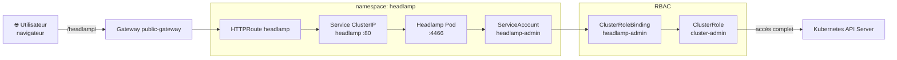

# Headlamp — Tableau de bord Kubernetes

Headlamp est une interface web open-source pour Kubernetes. Elle permet de visualiser et gérer les ressources du cluster (pods, deployments, services, namespaces, logs, etc.) depuis un navigateur.

## Architecture des composants



## Déploiement

Headlamp est déployé via deux mécanismes combinés :

1. **Helm** — installe/met à jour le chart officiel Headlamp
2. **Kustomize** — applique les ressources complémentaires (ServiceAccount, RBAC, exposition réseau)

> Note : ces commandes sont exécutées sur le **master** (control-plane), car c'est lui qui possède le kubeconfig admin
> (`/etc/kubernetes/admin.conf`) permettant d'administrer le cluster.

```bash
helm upgrade --install headlamp headlamp/headlamp --namespace headlamp --create-namespace
kubectl apply -k infra/headlamp/
```

### Déploiement via Ansible (recommandé)

Pour automatiser le déploiement sur les instances EC2, on utilise Ansible pour exécuter Helm puis appliquer `infra/headlamp/`
sur le host `k8s_master` (jump host + kubeconfig admin).

```bash
cd ansible
ansible-playbook -i inventory.yml deploy_headlamp.yml
```

Le playbook force le **Pod** Headlamp sur **worker1** : un `nodeSelector` cible le nœud Kubernetes dont l’adresse interne correspond à `worker1` dans `inventory.yml` (IP privée du VPC).

## Accès via Gateway (recommandé)

Prérequis : `install_gateway-api.yml` + `deploy_gateway.yml` (comme pour Grafana).

| Service  | URL (depuis Internet)           |
| -------- | ------------------------------- |
| Headlamp | `http://<IP_master>/headlamp/` |

Le chart Helm est configuré avec `baseURL: /headlamp`. Le port **TCP 80** du master doit être ouvert dans le security group AWS.

Vérification sur le master :

```bash
sudo KUBECONFIG=/etc/kubernetes/admin.conf kubectl get httproute,pods,svc,endpoints -n headlamp
```

## RBAC

Le `ClusterRoleBinding` attache le ServiceAccount `headlamp-admin` au `ClusterRole` dédié **`headlamp-viewer`** (défini dans `infra/headlamp/clusterrole.yaml`).

Ce rôle accorde uniquement `get/list/watch` sur les ressources nécessaires à l’affichage dans Headlamp : workloads (pods, deployments, daemonsets, statefulsets…), services, namespaces, nœuds, RBAC, ingresses, stockage, etc. **Aucune écriture n’est autorisée.**

> Note : les `Secrets` sont volontairement exclus — Headlamp n’en a pas besoin pour visualiser le cluster, et les exposer via une UI web serait un vecteur de risque inutile.

## Authentification

Headlamp s’authentifie avec un **token Kubernetes** du ServiceAccount `headlamp-admin`. Le playbook **ne génère ni n’enregistre** de token : ainsi rien ne transite dans les sorties Ansible, les logs ou un fichier prévisible sur le master.

Sur le **master**, après déploiement, crée un token **quand tu en as besoin** (durée limitée, ex. 48h) :

```bash
sudo KUBECONFIG=/etc/kubernetes/admin.conf kubectl create token headlamp-admin -n headlamp --duration=48h
```

Colle le jeton **une seule fois** dans l’UI Headlamp ; **ne le copie pas** dans des tickets, chats ou commits. Pour une nouvelle session, régénère un token avec la même commande.

### Chemin Kustomize côté Ansible

Le rôle charge les fichiers depuis `headlamp_kustomize_src` (défaut : relatif au playbook, voir `roles/headlamp/defaults/main.yml`). Tu peux surcharger ce chemin si le dépôt n'est pas à la racine attendue.