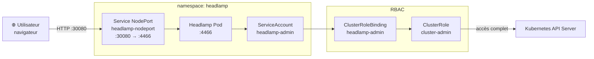

# Headlamp — Tableau de bord Kubernetes

Headlamp est une interface web open-source pour Kubernetes. Elle permet de visualiser et gérer les ressources du cluster (pods, deployments, services, namespaces, logs, etc.) depuis un navigateur.

## Architecture des composants



## Déploiement

Headlamp est déployé via deux mécanismes combinés :

1. **Helm** — installe/met à jour le chart officiel Headlamp
2. **Kustomize** — applique les ressources complémentaires (ServiceAccount, RBAC, exposition réseau)

```bash
helm upgrade --install headlamp headlamp/headlamp --namespace headlamp --create-namespace
kubectl apply -k infra/headlamp/
```

## Authentification

Headlamp utilise les tokens Kubernetes pour l'authentification. Pour générer un token d'accès depuis le ServiceAccount `headlamp-admin` :

```bash
kubectl create token headlamp-admin -n headlamp
```

Coller le token dans l'interface web au moment de la connexion.