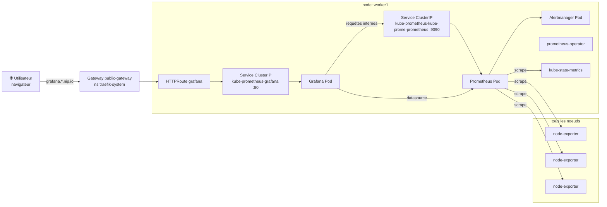

# Monitoring — Prometheus, Grafana, node-exporter

La stack de monitoring est déployée via un seul chart Helm (`kube-prometheus-stack`) qui installe en une fois Prometheus, Grafana, Alertmanager, kube-state-metrics et node-exporter, le tout orchestré par `prometheus-operator`.

## Architecture des composants



## Composants installés

| Composant            | Rôle                                                                     | Localisation                          |
| -------------------- | ------------------------------------------------------------------------ | ------------------------------------- |
| Prometheus           | Collecte et stocke les métriques du cluster                              | worker1 (`nodeSelector`)              |
| Grafana              | Interface web pour visualiser les métriques via des dashboards           | worker1                               |
| Alertmanager         | Gère les alertes générées par Prometheus                                 | worker1                               |
| prometheus-operator  | Gère le cycle de vie des ressources Prometheus/Alertmanager              | worker1                               |
| kube-state-metrics   | Expose l'état des objets Kubernetes (pods, deployments, etc.) en métriques | worker1                             |
| node-exporter        | Expose les métriques système (CPU, RAM, disque, réseau) de chaque noeud   | DaemonSet sur **tous** les noeuds      |

> Note : le `nodeSelector` worker1 est codé en dur (nom AWS `ip-10-0-3-198.eu-west-3.compute.internal`) dans les manifests statiques. `local-path-provisioner` est aussi épinglé sur worker1 (`infra/local-path-storage/`) pour que les PVC monitoring soient provisionnés au bon endroit.

## Déploiement via Ansible (recommandé)

Le déploiement est entièrement automatisé par le rôle Ansible `monitoring`. Le playbook s'exécute sur le host `k8s_master` qui possède le kubeconfig admin (`/etc/kubernetes/admin.conf`).

```bash
cd ansible
ansible-playbook -i ansible/inventory.yml ansible/deploy_monitoring.yml
```

Le playbook effectue les étapes suivantes :

1. Applique **local-path-provisioner** via `kubectl apply -k infra/local-path-storage/` (manifest amont vendorisé + patches kustomize : épinglage worker1, StorageClass par défaut), puis attend que le Deployment soit `Ready`.
2. Ajoute le repo Helm `prometheus-community` puis met à jour le cache des repos.
3. Crée le namespace `monitoring` (`infra/monitoring/namespace.yaml`) et applique les `SealedSecret` Grafana / OAuth **avant** Helm.
4. Installe le chart `kube-prometheus-stack` avec `infra/monitoring/values.yaml`.
5. Installe les CRD Gateway API si elles sont absentes.
6. Applique le reste des manifests (`infra/monitoring/`, via Kustomize : HTTPRoutes, NetworkPolicies) vers le Gateway `public-gateway`.

Déploiement complet (connectivité + cluster + metrics-server + sealed-secrets + Traefik + cert-manager + Dex + monitoring + Loki + headlamp + app) :

```bash
ansible-playbook deploy_all.yml
```

> Note : la StorageClass `local-path` est nécessaire pour fournir des PersistentVolumes à Prometheus (rétention de 15 jours, 20 Gi), Grafana (5 Gi) et Alertmanager (2 Gi).

## Configuration

La **configuration applicative** de la stack (Grafana SSO/datasources, tailles et rétention des PVC, hostnames, ciblage worker1) vit dans `infra/monitoring/values.yaml` **source unique, statique**, partagée avec ArgoCD. Le rôle Ansible se contente de **copier `infra/monitoring/` sur le master** puis lancer `helm ... -f infra/monitoring/values.yaml` et `kubectl apply -k`.

| Réglage                           | Valeur                    | Où                                               |
| --------------------------------- | ------------------------- | ------------------------------------------------ |
| Taille volume Prometheus          | `20Gi`                    | `infra/monitoring/values.yaml`                   |
| Rétention métriques Prometheus    | `15d`                     | `infra/monitoring/values.yaml`                   |
| Secret admin Grafana              | `grafana-admin-credentials` | `infra/monitoring/values.yaml` (via SealedSecret) |
| Ciblage des pods stateful         | `nodeSelector` sur le nom AWS de worker1 (`ip-10-0-3-198.eu-west-3.compute.internal`) | `infra/monitoring/values.yaml` |

> ⚠️ Le `nodeSelector` est codé en dur sur le nom du node worker1. Si le node est recréé ou change d'IP interne, mettre à jour les 6 occurrences dans `infra/monitoring/values.yaml` **ainsi que** le patch `infra/local-path-storage/kustomization.yaml` (sinon pods `Pending`). Nom courant : `kubectl get nodes -o wide`.

Le **stockage** (local-path-provisioner) est lui aussi entièrement déclaratif dans `infra/local-path-storage/` : manifest amont `v0.0.36` vendorisé + patches kustomize (épinglage worker1, annotation StorageClass par défaut). Ansible applique simplement `kubectl apply -k`.

Les **variables Ansible résiduelles** (`ansible/roles/monitoring/defaults/main.yml`) ne couvrent plus que la **mécanique de déploiement** : `monitoring_namespace`, `monitoring_release_name`, coordonnées/version du chart (`85.0.3`), `monitoring_storage_class`, `local_path_storage_kustomize_src`, `local_path_provisioner_rollout_timeout`, `monitoring_kustomize_src`.

> ⚠️ **Important** : le `SealedSecret` Grafana est versionné dans `infra/monitoring/grafana-sealedsecret.yaml` (données chiffrées). Pour le (re)générer, suivre la procédure de `docs/sealed-secrets.md`. Aucun mot de passe en clair dans le dépôt.

## Accès via Gateway (après `deploy_traefik.yml`)

Le routage se fait **par hostname** (un HTTPRoute dédié, chemin `/`). Le hostname est dérivé de l'IP publique du master via [nip.io](https://nip.io) (`nip_suffix` = `<IP_master_avec_tirets>.nip.io`, défini dans `ansible/group_vars/all.yml`).

| Service    | Accès                                                                 |
| ---------- | --------------------------------------------------------------------- |
| Grafana    | `https://grafana.<IP_master_tirets>.nip.io/` (depuis Internet)        |
| Prometheus | **Interne uniquement** pas d'HTTPRoute (voir ci-dessous)            |

> Exemple avec l'IP `15.237.15.14` : `https://grafana.15-237-15-14.nip.io/`.

**Prometheus n'est volontairement pas exposé publiquement** (aucune authentification native). Grafana l'interroge via le service ClusterIP interne. Pour y accéder ponctuellement :

```bash
kubectl port-forward -n monitoring svc/kube-prometheus-kube-prome-prometheus 9090:9090
# puis http://localhost:9090
```

Prérequis : ports **TCP 80 et 443** ouverts sur le security group du master, et Gateway `public-gateway` (namespace `traefik-system`) déployé via `deploy_traefik.yml`. Le certificat TLS de `grafana.<nip>` est fourni par cert-manager (voir [docs/cert-manager.md](cert-manager.md)).

## Authentification Grafana

Identifiants par défaut :

- **utilisateur** : `admin`
- **mot de passe** : valeur scellée dans `grafana-admin-credentials` (voir `docs/sealed-secrets.md`)

À la première connexion, Grafana propose de changer le mot de passe. Prometheus est exposé **sans authentification** ; ne pas l'exposer publiquement sans protection supplémentaire (reverse-proxy, security group restrictif).

### SSO via Dex (OAuth)

Grafana propose en plus une connexion **« Sign in with Dex »** (OAuth générique) adossée aux comptes locaux Dex le mapping de rôle se fait par email (admin → `Admin`, sinon `Viewer`).
Le formulaire admin natif ci-dessus reste actif comme accès de secours. Détails et mise en place : [docs/dex.md](dex.md).

## Alertes de démo & tests de charge

Le chart déploie le jeu de règles **kube-prometheus-stack par défaut** (`KubePodCrashLooping`, `KubeNodeNotReady`, etc.), mais celles-ci se déclenchent à `for: ~15m` trop lent pour une démo live. Le manifest [`infra/monitoring/prometheusrule-demo.yaml`](../infra/monitoring/prometheusrule-demo.yaml) ajoute des versions **accélérées (`for: 1m`)** dédiées aux démos :

| Alerte | Démo | Condition |
| ------ | ---- | --------- |
| `DemoPodCrashLooping` | rollback | un conteneur de `sample-app` redémarre en boucle |
| `DemoAppHighCpu` | autoscaling | CPU pod > 80% du request (`100m`) |
| `DemoAppHighMemory` | autoscaling | mémoire pod > 80% du request (`128Mi`) |
| `DemoNodeNotReady` | node | un noeud n'est plus `Ready` |

> ⚠️ Toute `PrometheusRule` custom **doit** porter le label `release: kube-prometheus`
> (`ruleSelectorNilUsesHelmValues=true`), sinon Prometheus l'ignore silencieusement.

### Stresser la sample-app (alertes CPU / mémoire)

Les alertes `DemoAppHighCpu` / `DemoAppHighMemory` sont scopées sur `container="sample-app"` : il faut donc charger **ce conteneur** (pas un pod tiers). Les deux commandes s'arrêtent seules au bout de 4 min (`timeout 240`) ; pour couper avant, `Ctrl-C` ou `kubectl -n sample-app rollout restart deploy/app-sample-app`.

```bash
# CPU : une boucle shell sature le quota CPU (throttlé à la limite 500m → ratio 5x le request)
kubectl -n sample-app exec deploy/app-sample-app -c sample-app -- timeout 240 sh -c 'while :; do :; done'

# Mémoire : alloue ~150 Mo (> 80% du request 128Mi, < limite 512Mi donc pas d'OOMKill)
kubectl -n sample-app exec deploy/app-sample-app -c sample-app -- timeout 240 php -d memory_limit=-1 -r '$a = str_repeat("x", 150*1024*1024); sleep(600);'
```

Compter **~1 à 3 min** (fenêtre `rate[2m]` + `for: 1m`) avant le passage en `firing`. Visualiser
l'état dans Prometheus (`/alerts`) ou dans **Grafana → Alerting** (via la data source Alertmanager).

> Pour déclencher l'alerte CPU **et** le HPA (démo autoscaling « bout en bout »), préférer une charge HTTP sur le service plutôt qu'un burn local p. ex. un pod jetable : `kubectl -n sample-app run loadgen --rm -it --restart=Never --image=williamyeh/hey -- -z 5m -c 50 http://app-sample-app.sample-app/`

## Segmentation réseau (NetworkPolicy)

Par défaut, **tout pod du cluster** peut joindre Prometheus, Alertmanager ou kube-state-metrics (trafic est-ouest ouvert). Pour limiter ces services à leurs seuls interlocuteurs légitimes, le manifest [`infra/monitoring/networkpolicy.yaml`](../infra/monitoring/networkpolicy.yaml) applique (via **Calico**) des NetworkPolicies **ciblées** :

| Service cible | Ingress autorisé depuis |
| ------------- | ----------------------- |
| Prometheus `:9090` | Grafana (requêtes) + Prometheus (self-scrape) |
| Alertmanager `:9093` | Prometheus (alertes + scrape) + Grafana (data source + health check) + peers Alertmanager (`:9094`) |
| kube-state-metrics `:8080` | Prometheus |

Tout le reste (ex. un pod `sample-app`) est **refusé**. Les policies sont ciblées (sélecteur de pod) plutôt qu'un *default-deny* de namespace, pour ne pas casser les scrapes internes ni le flux Traefik (hostNetwork) → Grafana. Elles sont appliquées par `kubectl apply -k infra/monitoring/` (rôle `monitoring`).

> **Caveat `kubectl port-forward`** : le port-forward vers Prometheus provient du noeud (kubelet), pas d'un pod ; selon Calico il peut être bloqué par la policy. Si c'est le cas, ajouter un `from: [{ ipBlock: { cidr: <IP_noeud>/32 } }]` sur la policy Prometheus.

### node-exporter (hostNetwork) — restriction au niveau hôte

node-exporter tourne en **`hostNetwork: true`** (port **9100** sur l'IP de chaque noeud). Les NetworkPolicy Kubernetes **ne s'y appliquent pas**. Pour restreindre l'accès à `:9100` au seul Prometheus, il faut agir au niveau **hôte** :

- **AWS Security Group** : n'autoriser `:9100` que depuis l'IP/SG du noeud qui héberge Prometheus (worker1) ; ou
- **Calico `GlobalNetworkPolicy` + `HostEndpoints`** : politique sur les interfaces hôte (configuration plus avancée un `HostEndpoint` mal défini peut couper la connectivité du noeud, à tester prudemment).

node-exporter n'expose que des **métriques système en lecture seule**, sur le réseau des noeuds (non routé depuis l'extérieur) sa sensibilité est moindre que celle de Prometheus.
