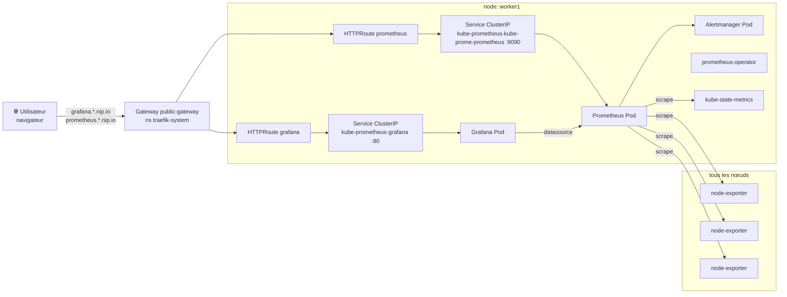

# Monitoring — Prometheus, Grafana, node-exporter

La stack de monitoring est déployée via un seul chart Helm (`kube-prometheus-stack`) qui installe en une fois Prometheus, Grafana, Alertmanager, kube-state-metrics et node-exporter, le tout orchestré par `prometheus-operator`.

## Architecture des composants



## Composants installés

| Composant            | Rôle                                                                     | Localisation                          |
| -------------------- | ------------------------------------------------------------------------ | ------------------------------------- |
| Prometheus           | Collecte et stocke les métriques du cluster                              | worker1 (`nodeSelector`)              |
| Grafana              | Interface web pour visualiser les métriques via des dashboards           | worker1                               |
| Alertmanager         | Gère les alertes générées par Prometheus                                 | worker1                               |
| prometheus-operator  | Gère le cycle de vie des ressources Prometheus/Alertmanager              | worker1                               |
| kube-state-metrics   | Expose l'état des objets Kubernetes (pods, deployments, etc.) en métriques | worker1                             |
| node-exporter        | Expose les métriques système (CPU, RAM, disque, réseau) de chaque nœud   | DaemonSet sur **tous** les nœuds      |

> Note : le nom du nœud worker1 est résolu depuis `inventory.yml` (IP interne `10.0.3.198`). `local-path-provisioner` est aussi épinglé sur worker1 pour que les PVC monitoring soient provisionnés au bon endroit.

## Déploiement via Ansible (recommandé)

Le déploiement est entièrement automatisé par le rôle Ansible `monitoring`. Le playbook s'exécute sur le host `k8s_master` qui possède le kubeconfig admin (`/etc/kubernetes/admin.conf`).

```bash
cd ansible
ansible-playbook -i inventory.yml deploy_monitoring.yml
```

Le playbook effectue les étapes suivantes :

1. Résout le nom du nœud Kubernetes `worker1` à partir de son IP interne (`inventory.yml`).
2. Installe **local-path-provisioner** si la StorageClass `local-path` n'existe pas, l'épingle sur worker1 et la marque comme StorageClass par défaut.
3. Ajoute le repo Helm `prometheus-community` puis met à jour le cache des repos.
4. Applique le `SealedSecret` Grafana (`infra/monitoring/grafana-sealedsecret.yaml`) **avant** Helm.
5. Génère le fichier `values.yaml` à partir du template et installe le chart `kube-prometheus-stack`.
6. Installe les CRD Gateway API si elles sont absentes.
7. Applique les HTTPRoutes (`infra/monitoring/`, via Kustomize) vers le Gateway `public-gateway`.

Déploiement complet (connectivité + cluster + metrics-server + sealed-secrets + Traefik + monitoring + headlamp + app) :

```bash
ansible-playbook deploy_all.yml
```

> Note : la StorageClass `local-path` est nécessaire pour fournir des PersistentVolumes à Prometheus (rétention de 15 jours, 20 Gi), Grafana (5 Gi) et Alertmanager (2 Gi).

## Variables principales (`ansible/roles/monitoring/defaults/main.yml`)

| Variable                          | Valeur par défaut         | Description                                      |
| --------------------------------- | ------------------------- | ------------------------------------------------ |
| `monitoring_namespace`            | `monitoring`              | Namespace dans lequel la stack est déployée      |
| `monitoring_chart_version`        | `85.0.3`                  | Version du chart `kube-prometheus-stack`         |
| `monitoring_storage_class`        | `local-path`              | StorageClass utilisée pour les PVC               |
| `monitoring_prometheus_pvc_size`  | `20Gi`                    | Taille du volume Prometheus                      |
| `monitoring_prometheus_retention` | `15d`                     | Durée de rétention des métriques Prometheus      |
| `grafana_admin_secret_name`       | `grafana-admin-credentials` | Secret admin Grafana (via SealedSecret)        |

> ⚠️ **Important** : le `SealedSecret` Grafana est versionné dans `infra/monitoring/grafana-sealedsecret.yaml` (données chiffrées). Pour le (re)générer, suivre la procédure de `docs/sealed-secrets.md`. Aucun mot de passe en clair dans le dépôt.

## Accès via Gateway (après `deploy_traefik.yml`)

Le routage se fait **par hostname** (un HTTPRoute dédié par service, chemin `/`). Les hostnames sont dérivés de l'IP publique du master via [nip.io](https://nip.io) (`monitoring_nip_suffix` = `<IP_master_avec_tirets>.nip.io`).

| Service    | URL (depuis Internet)                         |
| ---------- | --------------------------------------------- |
| Grafana    | `http://grafana.<IP_master_tirets>.nip.io/`    |
| Prometheus | `http://prometheus.<IP_master_tirets>.nip.io/` |

> Exemple avec l'IP `15.237.15.14` : `http://grafana.15-237-15-14.nip.io/`.

Prérequis : port **TCP 80** ouvert sur le security group du master, et Gateway `public-gateway` (namespace `traefik-system`) déployé via `deploy_traefik.yml`.

## Authentification Grafana

Identifiants par défaut :

- **utilisateur** : `admin`
- **mot de passe** : valeur scellée dans `grafana-admin-credentials` (voir `docs/sealed-secrets.md`)

À la première connexion, Grafana propose de changer le mot de passe. Prometheus est exposé **sans authentification** ; ne pas l'exposer publiquement sans protection supplémentaire (reverse-proxy, security group restrictif).
