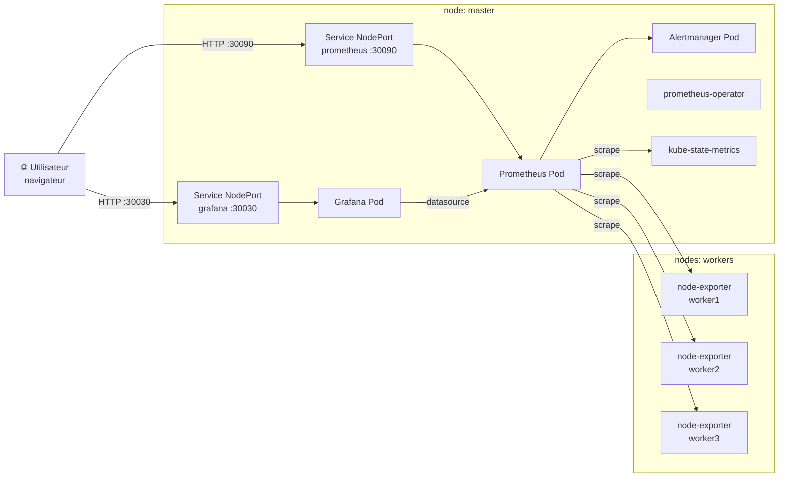

# Monitoring — Prometheus, Grafana, node-exporter

La stack de monitoring est déployée via un seul chart Helm (`kube-prometheus-stack`) qui installe en une fois Prometheus, Grafana, Alertmanager, kube-state-metrics et node-exporter, le tout orchestré par `prometheus-operator`.

## Architecture des composants



## Composants installés

| Composant            | Rôle                                                                     | Localisation |
| -------------------- | ------------------------------------------------------------------------ | ------------ |
| Prometheus           | Collecte et stocke les métriques du cluster                              | master       |
| Grafana              | Interface web pour visualiser les métriques via des dashboards           | master       |
| Alertmanager         | Gère les alertes générées par Prometheus                                 | master       |
| prometheus-operator  | Gère le cycle de vie des ressources Prometheus/Alertmanager              | master       |
| kube-state-metrics   | Expose l'état des objets Kubernetes (pods, deployments, etc.) en métriques | master       |
| node-exporter        | Expose les métriques système (CPU, RAM, disque, réseau) de chaque nœud   | workers      |

> Note : Prometheus et Grafana sont **épinglés sur le master** (via `nodeSelector` + tolérations sur `node-role.kubernetes.io/control-plane`) pour réserver les ressources des workers aux applications. À l'inverse, `node-exporter` tourne **uniquement sur les workers** afin de remonter leurs métriques système.

## Déploiement via Ansible (recommandé)

Le déploiement est entièrement automatisé par le rôle Ansible `monitoring`. Le playbook s'exécute sur le host `k8s_master` qui possède le kubeconfig admin (`/etc/kubernetes/admin.conf`).

```bash
cd ansible
ansible-playbook -i inventory.yml deploy_monitoring.yml
```

Le playbook effectue les étapes suivantes :

1. Vérifie que `kubectl` et `helm` sont installés (installe Helm si nécessaire).
2. Installe **local-path-provisioner** si la StorageClass `local-path` n'existe pas, et la marque comme StorageClass par défaut.
3. Ajoute le repo Helm `prometheus-community` puis met à jour les repos.
4. Génère le fichier `values.yaml` à partir du template et installe le chart `kube-prometheus-stack`.

> Note : la StorageClass `local-path` est nécessaire pour fournir des PersistentVolumes à Prometheus (rétention de 15 jours, 20 Gi), Grafana (5 Gi) et Alertmanager (2 Gi).

## Variables principales (`ansible/group_vars/all.yml`)

| Variable                          | Valeur par défaut         | Description                                      |
| --------------------------------- | ------------------------- | ------------------------------------------------ |
| `monitoring_namespace`            | `monitoring`              | Namespace dans lequel la stack est déployée      |
| `monitoring_chart_version`        | `85.0.3`                  | Version du chart `kube-prometheus-stack`         |
| `monitoring_storage_class`        | `local-path`              | StorageClass utilisée pour les PVC               |
| `monitoring_prometheus_pvc_size`  | `20Gi`                    | Taille du volume Prometheus                      |
| `monitoring_prometheus_retention` | `15d`                     | Durée de rétention des métriques Prometheus      |
| `grafana_admin_password`          | `admin`                   | Mot de passe admin Grafana (à surcharger)        |
| `grafana_nodeport`                | `30030`                   | NodePort exposant Grafana                        |
| `prometheus_nodeport`             | `30090`                   | NodePort exposant Prometheus                     |

> ⚠️ **Important** : Surcharger `grafana_admin_password` en production via `--extra-vars` ou un vault Ansible. Ne pas laisser la valeur par défaut.

## Authentification Grafana

Identifiants par défaut :

- **utilisateur** : `admin`
- **mot de passe** : valeur de `grafana_admin_password` (défaut : `admin`)

À la première connexion, Grafana propose de changer le mot de passe. Prometheus est exposé **sans authentification** ; ne pas l'exposer publiquement sans protection supplémentaire (reverse-proxy, security group restrictif).
