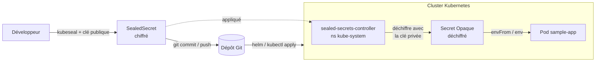

# Sealed Secrets - Gestion chiffrée des secrets

## Qu'est-ce que Sealed Secrets ?

[Sealed Secrets](https://github.com/bitnami-labs/sealed-secrets) (Bitnami) permet de **versionner des secrets dans Git en toute sécurité**. Un objet `SealedSecret` contient des données chiffrées avec la **clé publique** du contrôleur installé dans le cluster. Seul ce contrôleur, qui détient la **clé privée** correspondante, peut les déchiffrer pour produire un `Secret` Kubernetes classique.

Conséquence : le fichier `SealedSecret` est **sûr à committer** un attaquant qui le lit ne peut rien en faire sans la clé privée du cluster.

Dans ce projet, Sealed Secrets protège :

- les secrets applicatifs de `sample-app` (`APP_KEY` Laravel, mot de passe MySQL) -> `charts/sample-app/values.sealed.yaml` ;
- les identifiants admin de Grafana -> `infra/monitoring/grafana-sealedsecret.yaml` ;
- les secrets de Dex IDP (hash bcrypt admin, client secrets OAuth) -> `infra/dex/dex-sealedsecret.yaml` ;
- le client secret OAuth Grafana/Dex -> `infra/monitoring/grafana-oauth-sealedsecret.yaml`.

> La procédure de scellement de ces deux fichiers (ils partagent le même `GRAFANA_CLIENT_SECRET`) est décrite dans [`docs/dex.md`](dex.md).

## Architecture



1. Le développeur scelle un secret en clair avec `kubeseal` et la **clé publique** du cluster.
2. Le `SealedSecret` (chiffré) est committé dans Git, puis appliqué sur le cluster (via Helm ou `kubectl apply`).
3. Le **contrôleur** détecte le `SealedSecret`, le déchiffre avec sa clé privée et crée le `Secret` Kubernetes correspondant.
4. Les pods consomment le `Secret` normalement (variables d'environnement, fichiers montés).

## Composants

| Élément | Rôle | Localisation |
| ------- | ---- | ------------ |
| `sealed-secrets-controller` | Déchiffre les `SealedSecret` et crée les `Secret` | Deployment `kube-system` |
| `kubeseal` (CLI) | Scelle un secret côté client avec la clé publique | Machine locale / master |
| Clé publique (certificat) | Chiffre les données partageable librement | `ansible/sealed-secrets.pem` (non versionné) |
| Clé privée | Déchiffre **ne quitte jamais le cluster** | Secret `kube-system` (`sealedsecrets.bitnami.com/sealed-secrets-key`) |

## Déploiement du contrôleur (Ansible)

Le contrôleur est installé via Helm par le rôle `sealed_secrets` (playbook `deploy_sealed_secrets.yml`), également inclus dans `deploy_all.yml` (tag `sealed-secrets`).

```bash
cd ansible
ansible-playbook -i ansible/inventory.yml ansible/deploy_sealed_secrets.yml
# ou dans le flux complet :
ansible-playbook -i ansible/inventory.yml ansible/deploy_all.yml --tags sealed-secrets
```

Étapes du rôle (`roles/sealed_secrets/tasks/main.yml`) :

1. Ajoute le repo Helm `sealed-secrets` (`https://bitnami-labs.github.io/sealed-secrets`).
2. Met à jour le cache des repos Helm.
3. Copie `infra/sealed-secrets/` sur le master, puis installe / met à jour le chart `sealed-secrets` dans `kube-system` avec `helm ... -f infra/sealed-secrets/values.yaml`.
4. Vérifie que le Deployment est disponible.

> La **config Helm** du contrôleur (`fullnameOverride: sealed-secrets-controller`) vit dans `infra/sealed-secrets/values.yaml` **source unique, statique**, partagée avec ArgoCD (même modèle que Dex et monitoring). Le rôle Ansible ne fait que copier ce répertoire puis lancer Helm.

### Paramètres (`roles/sealed_secrets/defaults/main.yml`)

| Variable | Valeur par défaut |
| -------- | ----------------- |
| `sealed_secrets_controller_namespace` | `kube-system` |
| `sealed_secrets_controller_version` | `0.32.2` |
| `sealed_secrets_chart_version` | `2.17.7` |
| `sealed_secrets_release_name` | `sealed-secrets` |
| `sealed_secrets_chart_repo_url` | `https://bitnami.github.io/sealed-secrets` |

> ⚠️ La version du CLI `kubeseal` doit correspondre à celle du contrôleur (`sealed_secrets_controller_version`) pour éviter les incompatibilités de format.

## Utilisation dans le chart `sample-app`

Le template `charts/sample-app/templates/sealedsecret.yaml` génère un `SealedSecret` lorsque `secrets.useSealedSecrets: true`. Les valeurs chiffrées sont fournies dans `charts/sample-app/values.sealed.yaml` (versionné) :

```yaml
secrets:
  useSealedSecrets: true
  scope: strict          # strict | namespace-wide | cluster-wide
  encryptedData:
    appKey: "Ag..."      # APP_KEY Laravel chiffré
    dbPassword: "Ag..."  # mot de passe MySQL chiffré
```

Pour (re)générer les valeurs chiffrées `appKey` / `dbPassword`, sceller chaque secret avec `kubeseal` (voir la [procédure rapide](#procédure-rapide-mémo) en bas de page) puis reporter les chaînes obtenues dans `encryptedData` de `values.sealed.yaml`. Le secret cible se nomme `app-sample-app-app-secrets` (namespace `sample-app`, scope `strict`).

> `sealed-secrets.example.yaml` est uniquement un **exemple de structure** : ne pas le confondre avec `values.sealed.yaml`. Voir aussi [`docs/helm.md`](helm.md).

## Les scopes (portée du chiffrement)

Le scope détermine où un `SealedSecret` peut être déchiffré. Il doit être identique au scellement et à l'application.

| Scope | Contrainte | Annotation |
| ----- | ---------- | ---------- |
| `strict` (défaut) | Même **nom** ET même **namespace** | _(aucune)_ |
| `namespace-wide` | Même **namespace**, nom libre | `sealedsecrets.bitnami.com/namespace-wide: "true"` |
| `cluster-wide` | N'importe quel nom / namespace | `sealedsecrets.bitnami.com/cluster-wide: "true"` |

> Le mode `strict` est le plus sûr et celui utilisé par défaut dans ce projet : renommer ou déplacer le secret invalide le déchiffrement.

## Récupérer le certificat (clé publique) du cluster

Le fichier `ansible/sealed-secrets.pem` n'est **pas versionné** il est propre à chaque cluster. À régénérer après un nouveau clone, un nouveau cluster ou une réinstallation du contrôleur.

Sur le master :

```bash
kubectl get secret -n kube-system \
  -l sealedsecrets.bitnami.com/sealed-secrets-key \
  -o jsonpath='{.items[0].data.tls\.crt}' | base64 -d
```

Copier l'output (de `-----BEGIN CERTIFICATE-----` à `-----END CERTIFICATE-----`) dans `ansible/sealed-secrets.pem` sur la machine locale.

> Si `ansible/sealed-secrets.pem` est absent ou correspond à un ancien cluster, les `SealedSecret` ne pourront pas être déchiffrés (la migration job de l'app reste bloquée en `Pending` jusqu'au timeout Helm).

## Vérification

```bash
# Contrôleur en marche
kubectl get pods -n kube-system -l app.kubernetes.io/name=sealed-secrets

# SealedSecret appliqué et Secret déchiffré généré
kubectl get sealedsecret -n sample-app
kubectl get secret app-sample-app-app-secrets -n sample-app

# Diagnostic du déchiffrement
kubectl describe sealedsecret app-sample-app-app-secrets -n sample-app
kubectl logs -n kube-system -l app.kubernetes.io/name=sealed-secrets
```

Voir aussi : [Déploiement avec Helm](helm.md), [Monitoring](monitoring.md), [GitOps](gitops.md).

## Procédure rapide (mémo)

Mémo pour **installer Kubeseal sur le serveur**, **sceller un mot de passe** et **récupérer le YAML pré-configuré** prêt à committer / appliquer.

### 1. Installer Kubeseal

> Adapter l'architecture (`linux-arm64` ou `linux-amd64`) et la version à celle du contrôleur (`kubeseal --version`).

```bash
VERSION="0.32.2"   # doit correspondre au contrôleur (sealed_secrets_controller_version)
curl -OL "https://github.com/bitnami-labs/sealed-secrets/releases/download/v${VERSION}/kubeseal-${VERSION}-linux-arm64.tar.gz"
tar -xvzf "kubeseal-${VERSION}-linux-arm64.tar.gz" kubeseal
install -m 755 kubeseal /usr/local/bin/kubeseal
kubeseal --version
```

### 2. Récupérer la clé publique du contrôleur

```bash
kubectl get secret -n kube-system \
  -l sealedsecrets.bitnami.com/sealed-secrets-key \
  -o jsonpath='{.items[0].data.tls\.crt}' | base64 -d > /tmp/sealed-secret.pem
```

### 3. Sceller un mot de passe et récupérer le YAML

```bash
kubectl create secret generic app-sample-app-app-secrets \
  --from-literal=app-key='<APP_KEY Laravel>' \
  --from-literal=db-password='<mot de passe MySQL>' \
  -n sample-app \
  --dry-run=client -o yaml \
  | kubeseal --format=yaml --cert /tmp/sealed-secret.pem --scope strict -o yaml \
  > /tmp/sealed-secret.yaml
```

> Les clés `app-key` et `db-password` sont celles consommées par le Deployment `sample-app`
> (`secretKeyRef`). Dans le chart, leurs valeurs chiffrées sont fournies via `encryptedData.appKey`
> / `encryptedData.dbPassword` de `values.sealed.yaml`.

Le fichier `/tmp/sealed-secret.yaml` contient le `SealedSecret` chiffré (clé `encryptedData`) **sûr à committer**. Il suffit ensuite de l'appliquer :

```bash
kubectl apply -f /tmp/sealed-secret.yaml
kubectl get secret app-sample-app-app-secrets -n sample-app   # vérifier le Secret déchiffré
```

> Le `--scope strict` impose que le nom (`app-sample-app-app-secrets`) **et** le namespace (`sample-app`) restent identiques au moment de l'application. Pour ajouter plusieurs clés, répéter `--from-literal=clé='valeur'` (ou `--from-file=clé=fichier`).
